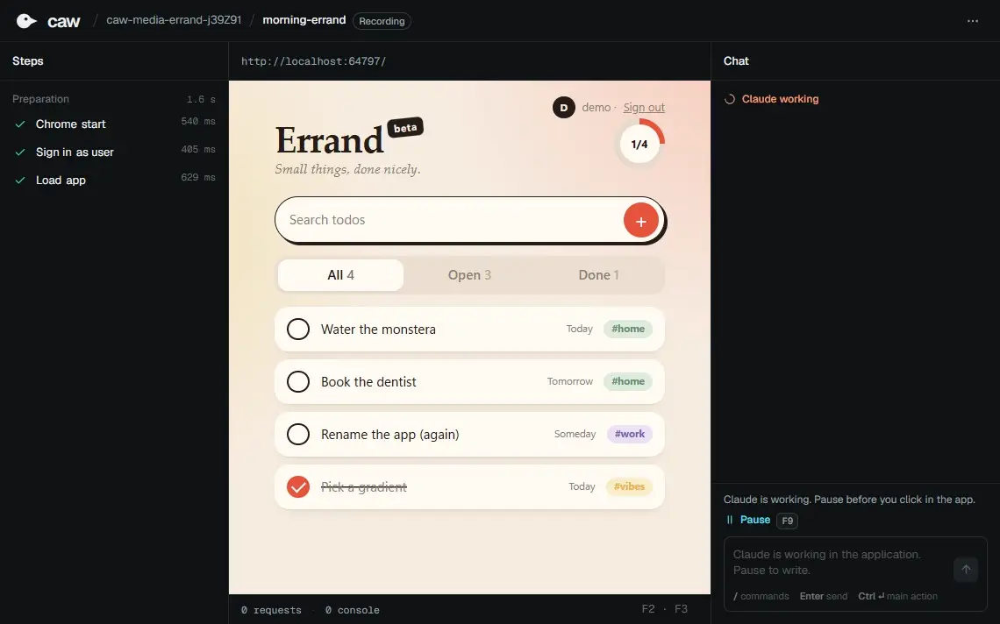
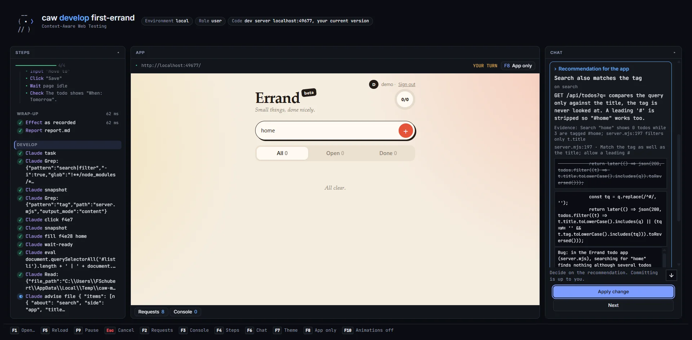

[English](README.md) · Deutsch

# caw-ai

[](https://github.com/lioninacoma/caw-ai/actions/workflows/ci.yml)
[](https://www.npmjs.com/package/caw-ai)
[](LICENSE)

> `caw` · *Context-Aware Web Testing*
>
> End-to-End-Regressionstests für deine eigene Web-App, in normaler Sprache geschrieben, einmal mit Claude aufgenommen, ohne KI abgespielt.
> Claude stellt deine Fehlertickets nach, und dieselben Tests bringen dich in jeden Zustand deiner App, um dort zu entwickeln.

- [Schnellstart](#schnellstart)
- [Tests in normaler Sprache, ohne KI abgespielt](#tests-in-normaler-sprache-ohne-ki-abgespielt)
- [Fehler nachstellen](#fehler-nachstellen)
- [Jeden Zustand erreichen und entwickeln](#jeden-zustand-erreichen-und-entwickeln)
- [Einordnen und reparieren](#einordnen-und-reparieren)
- [Aus Claude Code steuern](#aus-claude-code-steuern)
- [Sicher mit Zugangsdaten und Produktion](#sicher-mit-zugangsdaten-und-produktion)
- [Export nach Playwright](#export-nach-playwright)

## Schnellstart

Node 22.4+, Chrome und zum Aufnehmen [Claude Code](https://claude.com/claude-code). Starte deine App, dann:

```bash
npm i -D caw-ai
npx caw init --url http://localhost:5173   # schreibt caw.config.json
npx caw doctor                             # nennt, was noch fehlt
# einen Test in caw/tests/smoke.yaml beschreiben (Beispiel unten), dann:
npx caw record smoke --env local           # einmal, mit Claude
npx caw run smoke --env local              # ab dann ohne KI
```

Details unter [Installation und erster Test](#installation-und-erster-test); ohne eigene App zum Ausprobieren:
[`examples/errand`](examples/errand).

## Tests in normaler Sprache, ohne KI abgespielt

Du beschreibst Schritt für Schritt, was ein Nutzer tut. Du führst es in deiner App vor, oder Claude geht es für dich durch; du
gibst den Plan frei und übernimmst das Ergebnis. Ab dann spielt der Test mit Playwright ab, lokal und in CI: deterministisch,
schnell, ohne Tokens.



```yaml
# caw/tests/first-errand.yaml
id: first-errand
role: tester
writes: true
steps:
  - id: S1
    name: Aufgabe anlegen
    do: Lege die Aufgabe "Raben füttern {{runTag}}" mit dem Tag "#home" an.
    expect: Eine Bestätigung zeigt die Nummer der neuen Aufgabe, und sie steht oben in der Liste.
```

```bash
npx caw record first-errand --env local   # Claude führt die Schritte in Chrome aus, du übernimmst das Ergebnis
npx caw run first-errand --env local      # spielt die Aufnahme ab, ohne Claude
npx caw run --all --env staging --headless --report junit=out/caw.xml   # in CI
```

Eine Aufnahme speichert jedes Ziel als Playwright-Locator (Rolle, Name, Label, Text) neben dem Plan. Ein Test läuft auf jeder
Umgebung, zu der er passt (lokaler Dev-Server, Staging, ein CI-Stack, den caw selbst startet), schreibende Tests nur dort, wo
Schreiben erlaubt ist. `caw record <test>@S3` nimmt nach einer gewollten Änderung ab S3 neu auf. Details:
[Handbuch](docs/guide.de.md#tests-in-normaler-sprache-einmal-aufnehmen-ohne-ki-abspielen).

## Fehler nachstellen

Gib Claude ein Fehlerticket. Es meldet sich als Testrolle an, geht das Ticket selbstständig durch und sagt dir, ob der Fehler
echt ist: ja, nein oder unklar, mit dem Beobachteten gegen das Erwartete, seinen Schritten, Screenshots und einem Hinweis auf die
Ursache in deinem Code. Dazu schreibt es aus seinen Schritten den Entwurf eines Testplans: Ist der Fehler behoben, nimmst du
ihn als Regressionstest auf.


```bash
npx caw reproduce "Die Suche nach home findet nichts, obwohl Aufgaben mit #home getaggt sind." --env local
npx caw reproduce --file bug.md --from first-errand@S3 --env local --headless   # im Zustand eines Tests beginnen
```

Kein Plan zum Freigeben und keine Frage an dich: Claude untersucht nur. Es läuft nur auf Umgebungen, auf denen du Claude
zulässt, nie auf Produktion, liest nur, wo die Umgebung nicht `writable` ist, und ändert weder Code noch Tests. Bericht und
Entwurf bleiben im Laufordner. Details: [Handbuch](docs/guide.de.md#einen-fehler-nachstellen-reproduce).

## Jeden Zustand erreichen und entwickeln

`caw open <test>@S3` meldet sich mit der Rolle des Tests an, spielt bis zum Eingang von S3 ab und übergibt dir das Fenster:
seine Navigation erledigt, seine Eingaben offen. F1 („Öffnen…“) wählt jeden Test und Schritt der Umgebung, für jede Rolle.


Wähle ein Element in der App (`/element` im Chat) und frag danach: Claude liest deinen Quellcode und antwortet mit Datei
und Zeile. Gegen deinen Dev-Server lädt F5 deine Änderung.


```bash
npx caw open first-errand@S3 --env local   # der Zustand vor S3, angemeldet, das Fenster gehört dir
npx caw open --env local                   # die App, ohne Test
```

Details: [Handbuch](docs/guide.de.md#jeden-zustand-erreichen-und-entwickeln).

## Einordnen und reparieren

Bricht ein Schritt, sagt dir caw, ob Test, App oder Umgebung schuld ist, anhand der Requests, Konsolenausgaben und
Seitenänderungen aus der Aufnahme. Dafür braucht es keine KI. Im Chat findet Claude auf Wunsch die Ursache, „Schritt beheben“
nimmt nach einer gewollten Änderung nur diesen Schritt neu auf, und eine Korrektur der App kommt als Code-Änderung, die du
annimmst oder ablehnst: Füge einen Fehler in den Chat ein, und „Änderung übernehmen“ schreibt Claudes Korrektur.



```bash
npx caw run first-errand --env local --explain   # Claude erklärt einen Fehlschlag sofort
npx caw record first-errand@S3 --env local       # ab S3 bis zum Ende neu aufnehmen
```

Details: [Handbuch](docs/guide.de.md#einordnen-und-reparieren).

## Aus Claude Code steuern

Registriere caw als MCP-Server des Projekts und frag dann einfach Claude Code. Deine Sitzung richtet das Projekt ein, nimmt
auf, spielt ab, stellt Fehler nach und bringt dich in einen Zustand, und sie ist selbst der Agent, ohne zusätzliche Tokens.

```bash
claude mcp add caw --scope project -- npx caw-ai mcp
```

```
richte caw für dieses Projekt ein
nimm einen Test für das Anlegen eines Tickets auf
stell diesen Fehler nach: nach dem Speichern zeigt die Liste noch den alten Titel
bring mich auf die Ticket-Detailseite, ich will am Statusfeld arbeiten
```

Unter Windows (nicht WSL): `claude mcp add caw --scope project -- cmd /c npx caw-ai mcp`. `caw init` stellt den Eintrag auf die
installierte Kopie um, sobald caw in `node_modules` liegt. Um mit deiner Session in einem caw-Fenster zu arbeiten, gib
`/caw-attach` ein (den Skill schreiben `caw init` und `caw skill`) oder hänge `--attach` an `run`, `record`, `open` oder `reproduce`. Details: [Handbuch](docs/guide.de.md#aus-claude-code-steuern).

## Sicher mit Zugangsdaten und Produktion

- **Testkonten bleiben bei dir:** Du trägst sie selbst in `caw/.env` (oder CI-Secrets) ein. caw meldet sich an, fragt nie
  danach und schreibt sie nie; das Claude, das caw startet, kann die Datei nicht lesen (mit `--attach` gelten die Rechte
  deiner eigenen Session), und das Passwort wird in allem, was Claude bekommt, maskiert.
- **Produktion wird nur gelesen:** Ein Lauf auf Produktion sendet keine schreibenden Requests, und Produktions-Hosts sind von
  jeder anderen Umgebung aus unerreichbar. Claude arbeitet nie auf Produktion.
- **Claude bleibt in seinem Rahmen:** Es bedient den Browser nur über feste Befehle, und solange es dabei ist, erreicht der
  Browser nur deine Umgebungen und die Hosts, die du erlaubst. Lokal bekommt Claude Code nur lesende Werkzeuge, in Docker eine
  Firewall.

Anmeldung: Anmeldeformulare, Einmalcodes, Schritte bei einem Identitätsanbieter (etwa Keycloak), HTTP Basic, gespeicherte
Sitzungen. Was die Maske kann und was nicht: [Daten und Datenschutz](#daten-und-datenschutz) und
[Sandbox-Grenzen](docs/guide.de.md#sandbox-grenzen).

## Export nach Playwright

`caw export <test>` schreibt den aufgenommenen Test als Playwright-Test, der ohne caw läuft, nur mit `@playwright/test`: die
aufgenommenen Locators, ein `test.step()` je Schritt, die Anmeldung inklusive.

```bash
npx caw export first-errand --env local
npx playwright test -c caw/export/playwright
```

Details: [Befehle](docs/commands.de.md#export).

## Voraussetzungen

- Node 22.4+ und Google Chrome (oder ein anderer Chromium-Browser) unter Windows oder Linux (macOS ungetestet)
- [Claude Code](https://claude.com/claude-code), nur zum Aufnehmen, Nachstellen und Beheben
- Docker, nur wenn Claude in einem Container laufen soll (`--agent docker`)

Läuft mit einfachen Web-Apps, React, Vue, Angular, Next.js, Nuxt und serverseitig gerenderten Mehrseiten-Apps.
Erweiterungen ergänzen [ExtJS](docs/extensions/extjs.de.md) und [lokalen Code auf ausgelieferten Portalen](docs/extensions/overlay.de.md).

### Claude-Zugang und Kosten

caw ruft Claude nicht selbst auf. Es startet dein eigenes Claude Code (`--agent local`), arbeitet als Werkzeug in deiner
Claude-Code-Sitzung (`--attach`) oder reicht zur Laufzeit deinen eigenen `ANTHROPIC_API_KEY` in den Container
(`--agent docker`, nur API-Key); es liest oder speichert ihn nie. Welche Bedingungen gelten, hängt von deinem Konto ab: Pro- und
Max-Pläne sind für die private Nutzung; für Firmenprojekte und CI nimm einen Team- oder Enterprise-Plan oder einen API-Key aus
der Claude Console. Die Einhaltung der Bedingungen von Anthropic liegt bei dir.

Claude läuft nur beim Aufnehmen, Nachstellen, Beheben oder wenn du im Chat fragst; Wiedergaben verbrauchen keine Tokens. Die
Nutzung wird über dein Konto abgerechnet. Zum Begrenzen setzt du ein Modell und ein Budget je Claude-Lauf:

```json
"agent": { "model": "haiku", "maxBudgetUsd": 0.5 }
```

oder für einen Lauf `CAW_AGENT_MODEL=haiku CAW_CLAUDE_BUDGET=0.5`. caw gibt sie als `--model` und `--max-budget-usd` an
Claude Code weiter.

## Installation und erster Test

```bash
npm i -D caw-ai
```

Starte deine App, dann:

```bash
npx caw init --url http://localhost:5173   # schreibt caw.config.json; mit --explore-only sieht es sich die App an und du meldest dich einmal an
npx caw doctor                             # nennt, was noch fehlt
```

Beschreibe einen Test in `caw/tests/smoke.yaml`:

```yaml
id: smoke
role: tester
writes: false
steps:
  - id: S1
    name: Dashboard öffnen
    do: Öffne "Dashboard" in der Navigation.
    expect: Das Dashboard ist zu sehen.
```

Einmal aufnehmen, ab dann abspielen:

```bash
npx caw record smoke --env local
npx caw run smoke --env local
```

[`examples/errand`](examples/errand) ist eine kleine Aufgaben-App mit Anmeldung und einem aufgenommenen Test, den du sofort
abspielen kannst; siehe [`examples`](examples).

### Häufige Befehle

| Aufgabe | Befehl |
|---|---|
| Einen Test ausführen | `caw run <test> --env local` |
| Wie in CI ausführen | `caw run <test> --env staging --headless` |
| Alle Tests ausführen, die zu einer Umgebung passen | `caw run --all --env staging` |
| Einen neuen Test aufnehmen | `caw record <test> --env local` |
| Ab einem geänderten Schritt bis zum Ende neu aufnehmen | `caw record <test>@S3 --env local` |
| Claude ein Fehlerticket nachstellen lassen | `caw reproduce "<ticket>" --env local` |
| Die App an den Anfang eines Schritts bringen und dort weiterentwickeln | `caw open <test>@S3 --env local` |
| Die App öffnen, ohne Test | `caw open --env local` |
| Claude Fehler sofort erklären lassen | `caw run <test> --env local --explain` |
| Einen Test nach Playwright exportieren | `caw export <test>` |
| Config und Tests prüfen | `caw validate` |

Exit-Codes: `0` bestanden, `1` gescheitert, `2` Umgebungsfehler, `3` ungültige Eingabe, `4` Aufnahme nötig. Alle Befehle und
Optionen: [docs/commands.de.md](docs/commands.de.md).

### In CI

```yaml
- run: npx caw validate
- run: npx caw run --all --env staging --headless --report junit=out/caw.xml
```

Mit gesetztem `CI` gibt es keinen Chat, und Claude startet nicht. Lokal aufnehmen, die Dateien einchecken, in CI abspielen. Die
Testnutzer übergibst du als Secrets, benannt nach der Rolle: `CAW_TESTER_USER`, `CAW_TESTER_PASSWORD` (und `CAW_TESTER_TOTP`
für Einmalcodes), optional je Umgebung mit Endung, z. B. `CAW_TESTER_USER__STAGING`. Eine Umgebung mit `start`-, `stop`- und
`reset`-Befehlen startet `--start`, und vor dem ersten schreibenden Test wird sie zurückgesetzt.

## Config

`caw.config.json` enthält Umgebungen, Anmeldung und Rollen. `init` schreibt sie dir:

```json
{
  "environments": {
    "local":   { "url": "http://localhost:5173", "agent": true, "writable": true },
    "staging": { "url": "https://staging.example.com" }
  },
  "signIn": { "type": "form", "path": "/login", "userSelector": "#email", "passwordSelector": "#password",
              "signedInSelector": "[data-testid=user-menu]" },
  "roles": { "tester": {} }
}
```

Hinweise für Claude stehen in der `caw/caw.md` des Projekts und in deiner eigenen `caw.md` neben deinen persönlichen
Einstellungen, für jedes Projekt. Siehe [docs/configuration.de.md](docs/configuration.de.md).

## Daten und Datenschutz

**Wenn Claude läuft** (`record`, `reproduce`, der Chat, `--explain`), sendet Claude Code an Anthropic, womit Claude arbeitet:
Seiteninhalte (Accessibility-Snapshots, `eval`-Ergebnisse, Screenshots), Zusammenfassungen von Konsole und Netzwerk, den
Projektcode, den es liest, deine Hinweise in `caw.md` und deine Chatnachrichten. Dein Claude-Code-Konto und seine Bedingungen
gelten.

**Maskiert oder gesperrt:** caw meldet sich selbst an; das Passwort der Rolle, Einmalcodes und mit `secret: true` markierte
Werte werden in allem, was Claude bekommt (auch Fehlermeldungen, URLs und Dialogtexte), durch `••••` ersetzt. Das verhindert,
dass ein Wert versehentlich bei Claude landet; ein absichtlich fehlgeleiteter Agent kann einen Wert in der Seite mit `eval`
umformen (zerlegen, kodieren) und so an der Maske vorbei lesen. `caw/.env`, `.env*`, `caw/.auth` und typische Schlüsseldateien sind
für Claude gesperrt (Deny-Regeln von Claude Code lokal, im Docker-Container ausgeblendet). Andere Geheimnisse in
Projektdateien, die Claude lesen darf, sind es nicht, und Claude sieht alles, was der Testnutzer in der App sieht: Nimm
Testkonten und Testdaten. Details: [Sandbox-Grenzen](docs/guide.de.md#sandbox-grenzen).

**Wiedergaben** (`run` ohne Chat, CI) senden nichts an eine KI.

**Keine Telemetrie:** caw meldet nirgendwohin etwas. Sein eigener Netzwerkverkehr geht an deine Umgebungen und `allowHosts`
und an das, was die Seiten der App selbst laden (Skripte, Schriften, Analytics), dazu Paket-Downloads beim Bau des
Docker-Images; in der Docker-Sandbox erreicht Claude Code nur die Anthropic-API
(`CLAUDE_CODE_DISABLE_NONESSENTIAL_TRAFFIC=1`).

**Der Browser liegt außerhalb dieser Firewall:** Chrome läuft auf deinem Rechner. Solange Claude dabei ist (record, reproduce,
ein Lauf mit Chat, `open`), geht jeder Request seiner Seiten nur an deine Umgebungen, `allowHosts` und `thirdPartyHosts`; alles
andere wird abgebrochen und im Lauf genannt, damit eine Seite, die Claude steuert, nicht weitergeben kann, was sie sieht. Ohne
Claude (Wiedergaben, CI) laden Seiten von jedem Host außer Produktion. Details: [Sandbox-Grenzen](docs/guide.de.md#sandbox-grenzen).

**Laufdaten** bleiben auf deinem Rechner in `.caw/runs/<lauf>/`: Bericht, `result.json`, Screenshots, Claudes Logs und
`trace.zip`. Der Trace enthält Seiteninhalte und Netzwerkdaten samt Cookies; lade ihn und Laufordner nicht öffentlich hoch.
`init` trägt `.caw/` in `.gitignore` ein.

## Warum nicht einfach Playwright?

Playwright, sein MCP-Server und seine Test-Agenten lassen Claude schon heute Tests schreiben, ausführen und reparieren, und caw
läuft auf Playwright. caw ergänzt, was generierter Testcode nicht mitbringt:

- **Prüfungen, die ein Agent behalten muss.** Jede Prüfung gehört zu einem Erwartungssatz in normaler Sprache. Solange die
  Erwartung bleibt, muss ein Agent, der einen Schritt behebt oder den Test neu aufnimmt, die Prüfung behalten; eine geänderte
  Erwartung entscheidest du.
  Zeigen die Belege auf deine Anwendung, nennt caw die Ursache, statt eine Änderung am Test anzubieten.
- **Einordnung ohne KI.** Ein Fehlschlag wird anhand von Requests, Konsole und gelernten Wirkungen als Test, Anwendung oder
  Umgebung eingeordnet (oder als unklar); haben zwei gesunde Läufe die Wirkungen eines Schritts gelernt, lassen geänderte
  Bedienelemente oder Konsolenmeldungen ihn standardmäßig scheitern.
- **Ein Rahmen für den Agenten** (wenn caw ihn startet): nur lesende Werkzeuge oder ein Container mit Firewall, ein Browser,
  der nur deine Umgebungen erreicht, Produktion nur lesend.
- **Zustände, nicht nur Tests.** Jeder Schritt jedes Tests ist ein Ort, den du öffnen, von dem aus du einen Fehler nachstellen
  oder an dem du entwickeln kannst.

Nimm Playwright direkt für Cross-Browser-Läufe, paralleles Sharding, Netzwerk-Mocking oder eine große Suite, die Entwickler im
Code pflegen. `caw export` schreibt einen aufgenommenen Test als Playwright-Spec; Einordnung und gelernte Wirkungen von caw
bleiben dabei zurück.

## Was caw nicht ist

- Ein autonomer Agent für exploratives Testen: Claude folgt deinem Plan oder deinem Fehlerticket.
- Eine Playwright-IDE: Du schreibst keine Locators und keinen Code (`caw export` ist der Ausweg).
- Ein Werkzeug für visuelle Diffs, API-, Last- oder Sicherheitstests: Schritte prüfen Inhalt und Zustand, keine Pixel.
- Ein Cross-Browser-Grid: nur Chromium.
- Ein Framework für Netzwerk-Mocks: Tests laufen gegen das echte Backend der Umgebung.
- Parallel: Tests laufen nacheinander.

Andere KI-Anbieter werden nicht unterstützt: Aufnehmen, Nachstellen, Beheben und der Chat brauchen Claude Code; Wiedergaben
brauchen keine KI.

## FAQ

**Kostet jeder Lauf Tokens?**
Nein. Aufnehmen, Nachstellen und der Chat verbrauchen Claude-Tokens, abgerechnet über dein Claude-Code-Konto; Wiedergaben
keine, lokal und in CI. Bevor Claude startet, fragt der Chat einmal je Lauf (nicht, wenn deine eigene Claude-Code-Sitzung der
Agent ist); den Hinweis kannst du abschalten. Das Lauflog zeigt die Kosten, die Claude Code meldet.

**Sieht Claude meine Passwörter?**
Nicht aus Versehen. caw meldet sich selbst an, bevor Claude startet (und nimmt während einer neuen Anmeldung keine Befehle
an), das Claude, das caw startet, kann `caw/.env` nicht lesen (eine verbundene Session hat ihre eigenen Rechte) und bedient
den Browser nur über feste Befehle, und das Passwort wird in allem, was
Claude bekommt, maskiert. Gegen einen absichtlich fehlgeleiteten Agenten ist die Maske kein Schutz: Mit `eval` kann er einen
Wert in der Seite umformen. Nimm deshalb Testkonten: Claude handelt als dieser Nutzer.

**Kann `reproduce` etwas kaputt machen?**
Nur wo du Claude schreiben lässt: Auf einer Umgebung ohne `writable` wird jeder schreibende Request gesperrt, Produktion ist nie
erlaubt, und Claude ändert weder Code noch Tests. Der Testentwurf kommt erst nach `caw/tests`, wenn du ihn dorthin kopierst.

**Was passiert, wenn sich die Oberfläche ändert?**
Der Schritt scheitert, und der Chat sagt dir, warum. War die Änderung gewollt, nimmt „Schritt beheben“ diesen Schritt neu auf;
der Rest des Tests bleibt, wie er ist.

**Meine App meldet über SSO an.**
Lass caw das Formular des Identitätsanbieters mit `signIn.steps` füllen (`init --explore-only` schlägt sie vor), oder melde
dich einmal von Hand mit `caw role login` an und lass caw die gespeicherte Sitzung nutzen.

**Meine App hat keine Anmeldung.**
Lass `signIn` und `roles` in der Config weg. `init` macht das für dich, wenn es kein Anmeldeformular findet.

**Ist das Playwright?**
Es steuert mit Playwright dein installiertes Chrome, und Aufnahmen speichern Playwright-Locators. Du schreibst keinen
Playwright-Code; `caw export` macht aus einem Test einen, wenn du aussteigen willst.

## Dokumentation

- [Handbuch](docs/guide.de.md): jedes Feature im Detail, Agenten, Werkbank, Chat, Einordnung von Fehlern, Sandbox
- [Befehle](docs/commands.de.md): jeder Befehl und jede Option, Exit- und Fehlercodes
- [Konfiguration](docs/configuration.de.md): `caw.config.json`, Umgebungen, Anmeldung, Rollen, `caw/.env`, `caw.md`
- [Testdateien](docs/test-files.de.md): Format von Testplan und Aufnahme, Platzhalter
- Erweiterungen: [Overlay](docs/extensions/overlay.de.md) (lokaler Code auf einer ausgelieferten Umgebung), [ExtJS](docs/extensions/extjs.de.md)

## Mitmachen

Issues und Pull Requests sind willkommen, siehe [CONTRIBUTING.md](CONTRIBUTING.md).

## Lizenz

MIT, siehe [LICENSE](LICENSE). Schriften und Grafiken: [NOTICE.md](NOTICE.md).

Claude und Claude Code sind Marken der Anthropic, PBC. caw ist weder mit Anthropic verbunden noch von Anthropic empfohlen.
