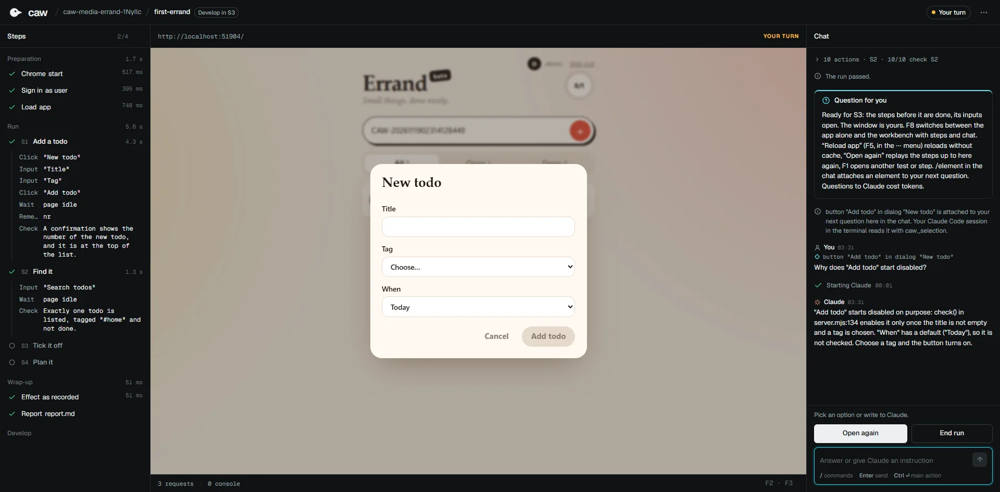

[English](README.md) · Deutsch

# caw-ai

[](https://github.com/lioninacoma/caw-ai/actions/workflows/ci.yml)
[](https://www.npmjs.com/package/caw-ai)
[](LICENSE)

> `caw` · *Context-Aware Web Testing*
>
> End-to-End-Regressionstests für deine eigene Web-App, in normaler Sprache geschrieben, einmal mit Claude aufgenommen, ohne KI abgespielt.

Du beschreibst Schritt für Schritt, was ein Nutzer tut. Du führst es in deiner App vor, oder Claude geht es für dich durch.
Ab dann spielt der Test mit Playwright ab, lokal und in CI: deterministisch, schnell, ohne Tokens. Bricht ein Schritt, sagt dir
caw, ob Test, App oder Umgebung schuld ist, und Claude repariert den Schritt in einem Chat neben der laufenden App.

Dieselben Tests bringen dich angemeldet in jeden Zustand deiner App, um dort zu entwickeln oder einen Fehler nachzustellen.


```yaml
# caw/tests/first-errand.yaml
id: first-errand
role: tester
writes: true
steps:
  - id: S1
    name: Aufgabe anlegen
    do: Lege die Aufgabe "Raben füttern {{runTag}}" mit dem Tag "#home" an.
    expect: Eine Bestätigung zeigt die Nummer der neuen Aufgabe, und sie steht oben in der Liste.
```

```bash
npx caw record first-errand --env local   # Claude führt die Schritte in Chrome aus, du übernimmst das Ergebnis
npx caw run first-errand --env local      # spielt die Aufnahme ab, ohne Claude
```

## So funktioniert es

- **Tests** sind YAML-Dateien mit Schritten in normaler Sprache. Eine Aufnahme speichert jedes Ziel als Playwright-Locator
  (Rolle, Name, Label, Text), neben dem Plan in `caw/recordings/`.
- **Aufnehmen:** Du führst im Fenster vor, oder Claude folgt dem Plan. Du gibst Pläne frei, die Daten schreiben, und
  entscheidest, ob eine Aufnahme übernommen wird. `caw record <test>@S3` nimmt nach einer gewollten Änderung ab S3 neu auf.
- **Abspielen** nutzt nur die Aufnahme: keine KI, keine Tokens, lokal und in CI. Ein Test läuft auf jeder Umgebung, zu der er
  passt (lokaler Dev-Server, Staging, ein CI-Stack, den caw selbst startet), schreibende Tests nur dort, wo Schreiben erlaubt
  ist, und auf Produktion schreibt er nie.
- **Einordnung:** Ein Fehlschlag wird als Test, App oder Umgebung eingeordnet, anhand der Requests, Konsolenausgaben und
  Seitenänderungen aus der Aufnahme. Im Chat repariert „Schritt beheben“ nur diesen Schritt.
- **Zustände erreichen:** `caw open <test>@S3` meldet sich mit der Rolle des Tests an, spielt bis S3 ab und übergibt dir das
  Fenster. Claude im Chat kann die Seite bedienen, ein eingefügtes Fehlerticket nachstellen und die Korrektur in deinem Code
  vorschlagen.
- **Anmeldung:** Anmeldeformulare, Einmalcodes, Schritte bei einem Identitätsanbieter (etwa Keycloak), HTTP Basic,
  gespeicherte Sitzungen. Testkonten trägst du selbst in `caw/.env` ein; caw fragt nie danach, und Claude sieht sie nie.
- **Ausstieg zu Playwright:** `caw export <test>` schreibt einen Playwright-Test, der ohne caw läuft.

Läuft mit einfachen Web-Apps, React, Vue, Angular, Next.js, Nuxt und serverseitig gerenderten Mehrseiten-Apps.
Erweiterungen ergänzen [ExtJS](docs/extensions/extjs.de.md) und [lokalen Code auf ausgelieferten Portalen](docs/extensions/overlay.de.md).

## Voraussetzungen

- Node 22.4+ und Google Chrome (oder ein anderer Chromium-Browser) unter Windows oder Linux (macOS ungetestet)
- [Claude Code](https://claude.com/claude-code), nur zum Aufnehmen und Beheben
- Docker, nur wenn Claude in einem Container laufen soll (`--agent docker`)

### Claude-Zugang und Kosten

caw ruft Claude nicht selbst auf. Es startet dein eigenes Claude Code (`--agent local`), arbeitet als Werkzeug in deiner
Claude-Code-Sitzung (`--agent session`) oder reicht zur Laufzeit deinen eigenen `ANTHROPIC_API_KEY` in den Container
(`--agent docker`, nur API-Key); es liest oder speichert ihn nie. Welche Bedingungen gelten, hängt von deinem Konto ab: Pro- und
Max-Pläne sind für die private Nutzung; für Firmenprojekte und CI nimm einen Team- oder Enterprise-Plan oder einen API-Key aus
der Claude Console. Die Einhaltung der Bedingungen von Anthropic liegt bei dir.

Claude läuft nur beim Aufnehmen, Beheben oder wenn du im Chat fragst; Wiedergaben verbrauchen keine Tokens. Die Nutzung wird
über dein Konto abgerechnet. Zum Begrenzen setzt du ein Modell und ein Budget je Claude-Lauf:

```json
"agent": { "model": "haiku", "maxBudgetUsd": 0.5 }
```

oder für einen Lauf `CAW_CLAUDE_MODEL=haiku CAW_CLAUDE_BUDGET=0.5`. caw gibt sie als `--model` und `--max-budget-usd` an
Claude Code weiter.

## Installation

```bash
npm i -D caw-ai
```

## Nutzung

Starte deine App, dann:

```bash
npx caw init --url http://localhost:5173   # schreibt caw.config.json; mit --explore-only sieht es sich die App an und du meldest dich einmal an
npx caw doctor                             # nennt, was noch fehlt
```

Beschreibe einen Test in `caw/tests/smoke.yaml`:

```yaml
id: smoke
role: tester
writes: false
steps:
  - id: S1
    name: Dashboard öffnen
    do: Öffne "Dashboard" in der Navigation.
    expect: Das Dashboard ist zu sehen.
```

Einmal aufnehmen, ab dann abspielen:

```bash
npx caw record smoke --env local
npx caw run smoke --env local
```

[`examples/errand`](examples/errand) ist eine kleine Aufgaben-App mit Anmeldung und einem aufgenommenen Test, den du sofort
abspielen kannst; siehe [`examples`](examples).

### Häufige Befehle

| Aufgabe | Befehl |
|---|---|
| Einen Test ausführen | `caw run <test> --env local` |
| Wie in CI ausführen | `caw run <test> --env staging --headless` |
| Alle Tests ausführen, die zu einer Umgebung passen | `caw run --all --env staging` |
| Einen neuen Test aufnehmen | `caw record <test> --env local` |
| Ab einem geänderten Schritt bis zum Ende neu aufnehmen | `caw record <test>@S3 --env local` |
| Die App an den Anfang eines Schritts bringen und dort weiterentwickeln | `caw open <test>@S3 --env local` |
| Die App angemeldet öffnen, ohne Test | `caw open --env local` |
| Claude Fehler sofort erklären lassen | `caw run <test> --env local --explain` |
| Einen Test nach Playwright exportieren | `caw export <test>` |
| Config und Tests prüfen | `caw validate` |

Exit-Codes: `0` bestanden, `1` gescheitert, `2` Umgebungsfehler, `3` ungültige Eingabe, `4` Aufnahme nötig. Alle Befehle und
Optionen: [docs/commands.de.md](docs/commands.de.md).

### In CI

```yaml
- run: npx caw validate
- run: npx caw run --all --env staging --headless --report junit=out/caw.xml
```

Mit gesetztem `CI` gibt es keinen Chat, und Claude startet nicht. Lokal aufnehmen, die Dateien einchecken, in CI abspielen. Die
Testnutzer übergibst du als Secrets, benannt nach der Rolle: `CAW_TESTER_USER`, `CAW_TESTER_PASSWORD` (und `CAW_TESTER_TOTP`
für Einmalcodes), optional je Umgebung mit Endung, z. B. `CAW_TESTER_USER__STAGING`. Eine Umgebung mit `start`-, `stop`- und
`reset`-Befehlen startet `--start`, und vor dem ersten schreibenden Test wird sie zurückgesetzt.

### Aus Claude Code

Registriere caw als MCP-Server des Projekts und frag dann einfach Claude Code:

```bash
claude mcp add caw --scope project -- npx caw-ai mcp
```

```
richte caw für dieses Projekt ein
nimm einen Test für das Anlegen eines Tickets auf
bring mich auf die Ticket-Detailseite, ich will am Statusfeld arbeiten
```

Unter Windows (nicht WSL): `claude mcp add caw --scope project -- cmd /c npx caw-ai mcp`. `caw init` stellt den Eintrag auf die
installierte Kopie um, sobald caw in `node_modules` liegt.

## Im Fenster arbeiten

`caw open <test>@S3` spielt einen Test bis zum Eingang von S3 ab und übergibt dir das Fenster, angemeldet; `caw open <test>`
spielt vorher den ganzen Test ab.

### Einen Test an einem Schritt öffnen

F1 („Öffnen…“) listet jeden Test der Umgebung, für jede Rolle. Wähle Test und Schritt; caw meldet sich frisch mit dem Konto
dieser Rolle an, spielt die Schritte davor ab und hält am Eingang des Schritts: seine Navigation erledigt, seine Eingaben offen.


### Entwickeln

Wähle ein Element in der App und frag danach. Claude liest deinen Quellcode und antwortet mit Datei und Zeile. Gegen deinen
Dev-Server lädt F5 deine Änderung.



### Einen Fehler mit Claude beheben

Füge ein Fehlerticket in den Chat ein. Claude stellt es im erreichten Zustand nach, nennt die Ursache und schlägt die Korrektur
als Änderung an deinem Code vor; „Änderung übernehmen“ schreibt sie.


Die Werkbank bringt [Themes](themes/README.md) mit (F7).

## Config

`caw.config.json` enthält Umgebungen, Anmeldung und Rollen. `init` schreibt sie dir:

```json
{
  "environments": {
    "local":   { "url": "http://localhost:5173", "claude": true, "writable": true },
    "staging": { "url": "https://staging.example.com" }
  },
  "signIn": { "type": "form", "path": "/login", "userSelector": "#email", "passwordSelector": "#password",
              "signedInSelector": "[data-testid=user-menu]" },
  "roles": { "tester": {} }
}
```

Siehe [docs/configuration.de.md](docs/configuration.de.md).

## Daten und Datenschutz

**Wenn Claude läuft** (`record`, der Chat, `--explain`), sendet Claude Code an Anthropic, womit Claude arbeitet: Seiteninhalte
(Accessibility-Snapshots, `eval`-Ergebnisse, Screenshots), Zusammenfassungen von Konsole und Netzwerk, den Projektcode, den es
liest, und deine Chatnachrichten. Dein Claude-Code-Konto und seine Bedingungen gelten.

**Maskiert oder gesperrt:** caw meldet sich selbst an; das Passwort der Rolle, Einmalcodes und mit `secret: true` markierte
Werte werden in allem, was Claude bekommt (auch Fehlermeldungen, URLs und Dialogtexte), durch `••••` ersetzt. Das verhindert,
dass ein Wert versehentlich bei Claude landet; ein absichtlich fehlgeleiteter Agent kann einen Wert in der Seite mit `eval`
umformen (zerlegen, kodieren) und so an der Maske vorbei lesen. `caw/.env`, `.env*`, `caw/.auth` und typische Schlüsseldateien sind
für Claude gesperrt (Deny-Regeln von Claude Code lokal, im Docker-Container ausgeblendet). Andere Geheimnisse in
Projektdateien, die Claude lesen darf, sind es nicht, und Claude sieht alles, was der Testnutzer in der App sieht: Nimm
Testkonten und Testdaten. Details: [Sandbox-Grenzen](docs/guide.de.md#sandbox-grenzen).

**Wiedergaben** (`run` ohne Chat, CI) senden nichts an eine KI.

**Keine Telemetrie:** caw meldet nirgendwohin etwas. Sein eigener Netzwerkverkehr geht an deine Umgebungen und `allowHosts`
und an das, was die Seiten der App selbst laden (Skripte, Schriften, Analytics), dazu Paket-Downloads beim Bau des
Docker-Images; in der Docker-Sandbox erreicht Claude Code nur die Anthropic-API
(`CLAUDE_CODE_DISABLE_NONESSENTIAL_TRAFFIC=1`).

**Der Browser liegt außerhalb dieser Firewall:** Chrome läuft auf deinem Rechner. Solange Claude dabei ist (record, ein Lauf
mit Chat, `open`), geht jeder Request seiner Seiten nur an deine Umgebungen, `allowHosts` und `thirdPartyHosts`; alles
andere wird abgebrochen und im Lauf genannt, damit eine Seite, die Claude steuert, nicht weitergeben kann, was sie sieht. Ohne
Claude (Wiedergaben, CI) laden Seiten von jedem Host außer Produktion. Details: [Sandbox-Grenzen](docs/guide.de.md#sandbox-grenzen).

**Laufdaten** bleiben auf deinem Rechner in `.caw/runs/<lauf>/`: Bericht, `result.json`, Screenshots, Claudes Logs und
`trace.zip`. Der Trace enthält Seiteninhalte und Netzwerkdaten samt Cookies; lade ihn und Laufordner nicht öffentlich hoch.
`init` trägt `.caw/` in `.gitignore` ein.

## Was caw nicht ist

- Ein autonomer Agent für exploratives Testen: Claude folgt deinem Plan.
- Eine Playwright-IDE: Du schreibst keine Locators und keinen Code (`caw export` ist der Ausweg).
- Ein Werkzeug für visuelle Diffs, API-, Last- oder Sicherheitstests: Schritte prüfen Inhalt und Zustand, keine Pixel.
- Ein Cross-Browser-Grid: nur Chromium.
- Ein Framework für Netzwerk-Mocks: Tests laufen gegen das echte Backend der Umgebung.
- Parallel: Tests laufen nacheinander.

Andere KI-Anbieter werden nicht unterstützt: Aufnehmen, Beheben und der Chat brauchen Claude Code; Wiedergaben brauchen keine KI.

## FAQ

**Kostet jeder Lauf Tokens?**
Nein. Aufnehmen und der Chat verbrauchen Claude-Tokens, abgerechnet über dein Claude-Code-Konto; Wiedergaben keine, lokal und
in CI. Bevor Claude startet, fragt der Chat einmal je Lauf (nicht, wenn deine eigene Claude-Code-Sitzung der Agent ist); den
Hinweis kannst du abschalten. Das Lauflog zeigt die Kosten, die Claude Code meldet.

**Sieht Claude meine Passwörter?**
Nicht aus Versehen. caw meldet sich selbst an, bevor Claude startet (und nimmt während einer neuen Anmeldung keine Befehle
an), Claude kann `caw/.env` nicht lesen und bedient den Browser nur über feste Befehle, und das Passwort wird in allem, was
Claude bekommt, maskiert. Gegen einen absichtlich fehlgeleiteten Agenten ist die Maske kein Schutz: Mit `eval` kann er einen
Wert in der Seite umformen. Nimm deshalb Testkonten: Claude handelt als dieser Nutzer.

**Was passiert, wenn sich die Oberfläche ändert?**
Der Schritt scheitert, und der Chat sagt dir, warum. War die Änderung gewollt, nimmt „Schritt beheben“ diesen Schritt neu auf;
der Rest des Tests bleibt, wie er ist.

**Meine App meldet über SSO an.**
Lass caw das Formular des Identitätsanbieters mit `signIn.steps` füllen (`init --explore-only` schlägt sie vor), oder melde
dich einmal von Hand mit `caw role login` an und lass caw die gespeicherte Sitzung nutzen.

**Meine App hat keine Anmeldung.**
Lass `signIn` und `roles` in der Config weg. `init` macht das für dich, wenn es kein Anmeldeformular findet.

**Ist das Playwright?**
Es steuert mit Playwright dein installiertes Chrome, und Aufnahmen speichern Playwright-Locators. Du schreibst keinen
Playwright-Code; `caw export` macht aus einem Test einen, wenn du aussteigen willst.

## Dokumentation

- [Befehle](docs/commands.de.md): jeder Befehl und jede Option, Exit- und Fehlercodes
- [Konfiguration](docs/configuration.de.md): `caw.config.json`, Umgebungen, Anmeldung, Rollen, `caw/.env`, `caw/caw.md`
- [Testdateien](docs/test-files.de.md): Format von Testplan und Aufnahme, Platzhalter
- [Leitfaden](docs/guide.de.md): Agenten, Werkbank, Chat, Einordnung von Fehlern, Sandbox
- Erweiterungen: [Overlay](docs/extensions/overlay.de.md) (lokaler Code auf einer ausgelieferten Umgebung), [ExtJS](docs/extensions/extjs.de.md)
- [Themes](themes/README.md): eingebaute Themes, eigene Theme-Pakete, `caw theme`

## Mitmachen

Issues und Pull Requests sind willkommen, siehe [CONTRIBUTING.md](CONTRIBUTING.md).

## Lizenz

MIT, siehe [LICENSE](LICENSE). Schriften und Grafiken: [NOTICE.md](NOTICE.md).
