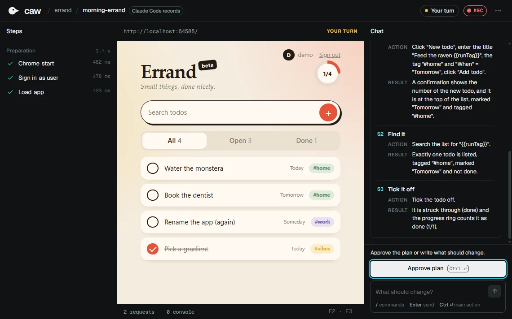
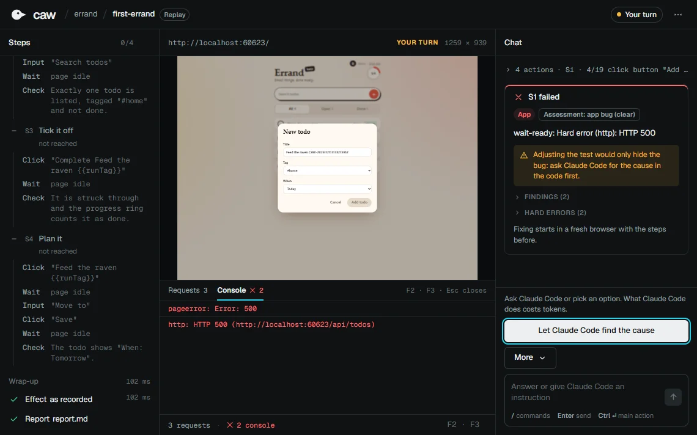
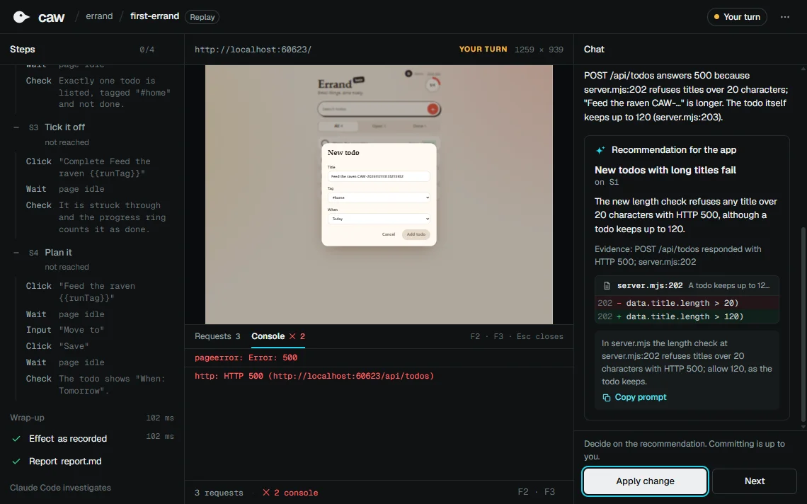
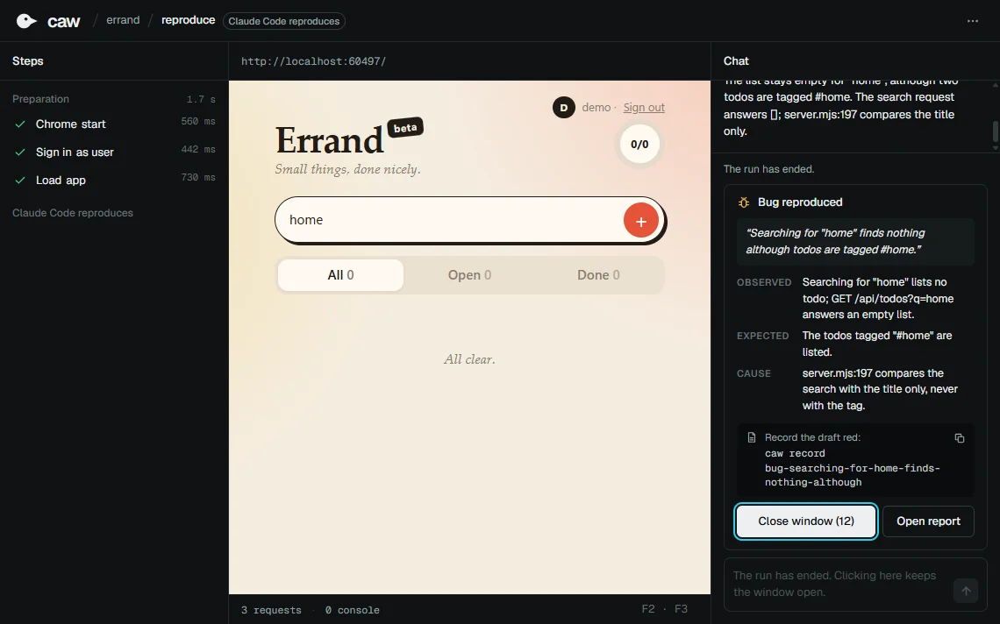
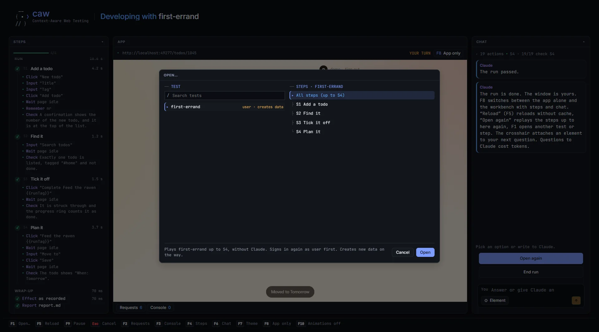

[English](README.md) · Deutsch

# caw-ai

[](https://github.com/lioninacoma/caw-ai/actions/workflows/ci.yml)
[](https://www.npmjs.com/package/caw-ai)
[](LICENSE)

> `caw` · *Context-Aware Web Testing*
>
> **Zielbild-getriebene Entwicklung für Web-Apps: Erst kommt der Test, caw prüft ihn ohne KI.**
>
> Der Testplan ist die Spezifikation, in normaler Sprache, bevor es den Bildschirm gibt. caw prüft ihn ohne KI, bis deine App
> das Ziel erreicht, und hält ihn danach als Regressionstest. Es ordnet einen Fehlschlag ohne KI der App, der Umgebung oder dem
> Test zu, hält einen Agenten an die Prüfungen, die er behalten muss, und bringt dich in jeden Zustand deiner App.


- [Warum nicht einfach Playwright?](#warum-nicht-einfach-playwright)
- [Schnellstart](#schnellstart)
- [Die Erwartung ist der Maßstab](#die-erwartung-ist-der-maßstab)
- [Test, App oder Umgebung, ohne KI](#test-app-oder-umgebung-ohne-ki)
- [Fehler nachstellen](#fehler-nachstellen)
- [Jeden Zustand erreichen und entwickeln](#jeden-zustand-erreichen-und-entwickeln)
- [Ein Rahmen für den Agenten](#ein-rahmen-für-den-agenten)
- [Visuelle Prüfungen](#visuelle-prüfungen)
- [Aus Claude Code steuern](#aus-claude-code-steuern)
- Nachschlagen: [Voraussetzungen](#voraussetzungen), [Befehle](#häufige-befehle), [CI](#in-ci), [Config](#config),
  [Daten und Datenschutz](#daten-und-datenschutz), [Was caw nicht ist](#was-caw-nicht-ist), [FAQ](#faq),
  [Dokumentation](#dokumentation)

## Warum nicht einfach Playwright?

Playwright, sein MCP-Server und seine Test-Agenten lassen einen Agenten schon heute Tests schreiben, ausführen und reparieren, und caw
läuft auf Playwright. caw ergänzt, was generierter Testcode nicht mitbringt:

- **Prüfungen, die ein Agent behalten muss.** Jede Prüfung gehört zu einem Erwartungssatz in normaler Sprache. Solange die
  Erwartung bleibt, muss ein Agent, der einen Schritt behebt oder den Test neu aufnimmt, die Prüfung behalten; sonst lehnt caw
  die Aufnahme ab. Eine geänderte Erwartung entscheidest du. Zeigen die Belege auf deine App, nennt caw die Ursache, statt
  eine Änderung am Test anzubieten.
- **Urteil ohne KI.** Ein Fehlschlag wird anhand von Requests, Konsole und gelernten Wirkungen als Test, App oder Umgebung
  eingeordnet (oder als unklar); haben fünf gesunde Läufe die Wirkungen eines Schritts gelernt, lassen geänderte
  Bedienelemente oder Konsolenmeldungen ihn standardmäßig scheitern.
- **Ein Ziel vor dem Bildschirm.** Noch nicht gebaute Schritte bleiben offen, mit Zielbild und dem, was auf der Seite sein muss.
  Läufe sagen ohne KI, wann ein Schritt bereit zum Aufnehmen ist, und messen seinen Bildschirm nach der Aufnahme am Zielbild.
- **Ein Rahmen für den Agenten** (wenn caw ihn startet): nur lesende Werkzeuge oder ein Container mit Firewall, ein Browser,
  der nur deine Umgebungen erreicht, Produktion nur lesend.
- **Zustände, nicht nur Tests.** Jeder Schritt jedes Tests ist ein Ort, den du öffnen, von dem aus du einen Fehler nachstellen
  oder an dem du entwickeln kannst.

Nimm Playwright direkt für Cross-Browser-Läufe, paralleles Sharding, Netzwerk-Mocking oder eine große Suite, die Entwickler im
Code pflegen.

### Export nach Playwright

Der Ausweg: `caw export <test>` schreibt einen aufgenommenen Test als Playwright-Test, der ohne caw läuft, nur mit
`@playwright/test`: die aufgenommenen Locators, ein `test.step()` je Schritt, die Anmeldung inklusive. Einordnung und gelernte
Wirkungen von caw bleiben dabei zurück.

```bash
npx caw export first-errand --env local
npx playwright test -c caw/export/playwright
```

Details: [Befehle](docs/commands.de.md#export).

## Schnellstart

Node 22.4+, Chrome und zum Aufnehmen [Claude Code](https://claude.com/claude-code). Starte deine App, dann:

```bash
npm i -D caw-ai
npx caw init --url http://localhost:5173   # schreibt caw.config.json; mit --explore-only sieht es sich vorher die App an
npx caw doctor                             # nennt, was noch fehlt
```

`init` fragt nach den Rollennamen und listet ihre Variablen in `caw/.env.example`. Den Testnutzer trägst du selbst in
`caw/.env` ein (`CAW_TESTER_USER`, `CAW_TESTER_PASSWORD`). Dann beschreibst du einen Test in `caw/tests/smoke.yaml`:

```yaml
id: smoke
role: tester
writes: false
steps:
  - id: S1
    name: Dashboard öffnen
    do: Öffne "Dashboard" in der Navigation.
    expect: Das Dashboard ist zu sehen.
```

Einmal aufnehmen, ab dann abspielen:

```bash
npx caw record smoke --env local   # einmal, mit dem Agenten
npx caw run smoke --env local      # ab dann ohne KI
```

Ohne eigene App zum Ausprobieren: [`examples/errand`](examples/errand) ist eine kleine Aufgaben-App mit Anmeldung und einem
aufgenommenen Test, den du sofort abspielen kannst.

## Die Erwartung ist der Maßstab

Ein Test ist ein Plan in normaler Sprache: je Schritt, was ein Nutzer tut, und ein erwartetes Ergebnis. Du zeigst den Weg in der
App oder beschreibst ihn im Chat; der Agent schlägt den Plan vor, du gibst ihn frei, und der Agent geht ihn durch. Sein Weg ist
die Aufnahme, und ein Lauf ohne KI prüft sie, bevor du sie übernimmst. Ab dann spielt der Test mit Playwright ab, lokal und in
CI: deterministisch, schnell, ohne Tokens.



```yaml
# caw/tests/first-errand.yaml
id: first-errand
role: tester
writes: true
steps:
  - id: S1
    name: Aufgabe anlegen
    do: Lege die Aufgabe "Raben füttern {{runTag}}" mit dem Tag "#home" an.
    expect: Eine Bestätigung zeigt die Nummer der neuen Aufgabe, und sie steht oben in der Liste.
  - id: S4
    name: Einplanen
    do: Öffne die Aufgabe und verschiebe sie auf "Tomorrow".
    expect: 'Die Aufgabe zeigt "When: Tomorrow".'
    design: design/todo-detail.html
    needs: ["getByRole('list', { name: 'Todos', exact: true })"]
```

Jede Prüfung gehört zu ihrem erwarteten Ergebnis. Solange die Erwartung bleibt, muss ein Agent, der den Schritt behebt oder neu
aufnimmt, die Prüfung behalten: Sonst lehnt caw die Aufnahme ab. Willst du eine Prüfung bewusst ändern, änderst du das
erwartete Ergebnis.

**Zielbilder.** Schreib die nächsten Schritte, bevor die App sie kann. Schritte am Ende, die noch nicht aufgenommen sind, bleiben
offen: `run` spielt den Rest ab, besteht und nennt sie. Ein Schritt kann den Bildschirm nennen, auf dem er enden soll
(`design:`, eine `.html` in `caw/design`), und was auf der Seite sein muss, bevor er aufgenommen werden kann
(`needs:`). Beides schreiben nur Menschen. Ein Lauf prüft die `needs` des ersten offenen Schritts und meldet „S4 ist bereit zum
Aufnehmen“, sobald sie da sind. Ist S4 aufgenommen, beurteilt jeder Lauf seinen Bildschirm ohne KI, nachdem seine Prüfung
bestanden hat (Bedienelemente, Überschriften, einige Stile je Bedienelement): Ist das Zielbild nicht
erreicht, scheitert der Schritt mit kind `design`, bis der Bildschirm passt. `caw open <test>@S4 --design` legt das Zielbild über
die App.

```bash
npx caw run first-errand --env local              # S1–S3 laufen, S4 offen; „bereit zum Aufnehmen“, sobald seine needs da sind
npx caw open first-errand@S4 --design --env local # das Zielbild über der App, die Abweichungen darunter
npx caw record first-errand@S4 --env local        # S4 aufnehmen, sobald der Bildschirm gebaut ist
```

Eine Aufnahme speichert jedes Ziel als Playwright-Locator (Rolle, Name, Label, Text) neben dem Plan. Ein Test läuft auf jeder
Umgebung, zu der er passt (lokaler Dev-Server, Staging, ein CI-Stack, den caw selbst startet), schreibende Tests nur dort, wo
Schreiben erlaubt ist. Details: [Handbuch](docs/guide.de.md#tests-in-normaler-sprache-einmal-aufnehmen-ohne-ki-abspielen),
[Zielbild](docs/guide.de.md#gegen-ein-zielbild-entwickeln), [offene Schritte](docs/test-files.de.md#offene-schritte).

## Test, App oder Umgebung, ohne KI

Bricht ein Schritt, sagt dir caw, ob Test, App oder Umgebung schuld ist, anhand der Requests und Konsolenausgaben, die es gesehen
hat, und der Wirkungen, die es gelernt hat. Dafür braucht es keine KI. Die Wirkungen eines Schritts lernt caw in seinen ersten
fünf gesunden Läufen, danach sind sie eingefroren: die Bedienelemente, die er ändert, seine Requests, die Form ihrer Antworten
und seine Konsolenmeldungen. Geänderte Bedienelemente oder neue Konsolenmeldungen lassen den Schritt standardmäßig scheitern,
der Rest warnt.





Im Chat findet der Agent auf Wunsch die Ursache, „Schritt beheben“ nimmt nach einer gewollten Änderung nur diesen Schritt neu
auf, und eine Korrektur der App kommt als Code-Änderung, die du annimmst oder ablehnst. Wurde nur ein Knopf umbenannt, belegt
caw das neue Ziel ohne KI und bietet es an.

- **`result.json`** listet jeden Schritt: Status, warum er scheiterte, seine Zeit, seine Requests und Wirkungen.
- **CI mit Einordnung:** JUnit typisiert einen gescheiterten Schritt nach der Einschätzung
  (`<failure type="app|environment|test|unclear">`); `--report summary=` schreibt eine Zeile je Test für die Job-Übersicht.
- **`--retry-env <n>`** wiederholt einen Test nur, solange er an der Umgebung scheitert.
- **`caw bisect`** findet mit `git bisect run` den Commit, der einen Test kaputt gemacht hat.
- **`caw audit <ref>`** listet jede Änderung, die einen Test schwächt (eine Prüfung geändert, obwohl ihre Erwartung blieb, ein
  Schritt entfernt, eine Zeitgrenze erhöht …), als Markdown für einen PR-Kommentar; Exit 1, wenn ein Test schwächer wurde.

```bash
npx caw run first-errand --env local --explain   # der Agent erklärt einen Fehlschlag sofort
npx caw run --all --env staging --headless --retry-env 1 --report junit=out/caw.xml --report summary=out/summary.md
npx caw audit origin/main                        # im PR: Ist ein Test schwächer geworden?
```

Details: [Einordnen und reparieren](docs/guide.de.md#einordnen-und-reparieren),
[audit](docs/guide.de.md#kein-test-wird-unbemerkt-schwächer-audit), [bisect](docs/commands.de.md#bisect),
[CI](docs/commands.de.md#mehrere-tests-ci).

## Fehler nachstellen

Gib dem Agenten ein Fehlerticket. Er meldet sich als Testrolle an, geht das Ticket selbstständig durch und sagt dir, ob der
Fehler echt ist: ja, nein oder unklar, mit dem Beobachteten gegen das Erwartete, seinen Schritten, Screenshots und einem Hinweis
auf die Ursache in deinem Code.



```bash
npx caw reproduce "Die Suche nach home findet nichts, obwohl Aufgaben mit #home getaggt sind." --env local
npx caw reproduce --file bug.md --from first-errand@S3 --ref BUG-42 --env local --headless
```

Ein nachgestellter Fehler hinterlässt einen Testentwurf in `caw/drafts`, den Weg zum belegten Fix:

1. **Rot:** `caw record <entwurf>` nimmt ihn auf; sein letzter Schritt muss scheitern, solange der Fehler da ist.
2. **Fix:** Du behebst den Fehler, von Hand oder mit deiner verbundenen Session.
3. **Grün:** `caw run <entwurf>` spielt ihn ohne KI ab.
4. **Übernehmen:** `caw run <entwurf> --promote` braucht den Entwurf und `run --all` grün, verschiebt ihn dann nach
   `caw/tests` und schreibt einen Fix-Bericht.

Mit Fenster führt dich der Chat in einem Prozess durch alle vier: **Rot aufnehmen**, **Jetzt den Fehler beheben** (selbst oder
mit dem Agenten, dessen Codeänderungen du Karte für Karte übernimmst), **Erneut testen** und **Übernehmen**.

Kein Plan zum Freigeben und keine Frage an dich: Der Agent untersucht nur. Er läuft nur auf Umgebungen, auf denen du einen
Agenten zulässt, nie auf Produktion, liest nur, wo die Umgebung nicht `writable` ist, und ändert weder Code noch Tests. `--ref`
hält eine Ticket-ID aus einem anderen Werkzeug im Bericht fest; caw schlägt sie nie nach. Details:
[Handbuch](docs/guide.de.md#einen-fehler-nachstellen-reproduce), [vom Fehler zum belegten Fix](docs/guide.de.md#vom-fehler-zum-belegten-fix),
[Tickets](docs/guide.de.md#tickets-aus-einem-anderen-werkzeug).

## Jeden Zustand erreichen und entwickeln

`caw open <test>@S3` meldet sich mit der Rolle des Tests an, spielt bis zum Eingang von S3 ab und übergibt dir das Fenster:
seine Navigation erledigt, seine Eingaben offen. F1 („Öffnen…“) wählt jeden Test und Schritt der Umgebung, für jede Rolle.



Wähle ein Element in der App (`/element` im Chat) und frag danach: Der Agent liest deinen Quellcode und antwortet mit Datei und
Zeile. Gegen deinen Dev-Server lädt F5 deine Änderung.


```bash
npx caw open first-errand@S3 --env local   # der Zustand vor S3, angemeldet, das Fenster gehört dir
npx caw open --env local                   # die App, ohne Test
```

Details: [Handbuch](docs/guide.de.md#jeden-zustand-erreichen-und-entwickeln).

## Ein Rahmen für den Agenten

Der Agent von caw bedient den Browser nur über feste Befehle, nie auf Produktion. Wo er läuft:

| Agent | Wie er läuft | Was er darf |
|---|---|---|
| `local` (Standard) | Claude Code auf deinem Rechner | das Projekt lesen (`Read`, `Grep`, `Glob`) und das caw-Werkzeug; keine Shell, kein Schreiben, kein Web; `caw/.env` und Schlüsseldateien gesperrt |
| `docker` (`--agent docker`) | Claude Code in einem Container, nur mit API-Key | das Projekt nur lesend, `.env`-Dateien ausgeblendet; die Firewall lässt nur die Anthropic-API durch |
| `--attach` | deine eigene Claude-Code-Session | die Rechte deiner Session; caw ergänzt die Browser-Befehle. Sie darf den Code der App ändern, wenn du im Chat darum bittest |

In jedem Fall gilt: Solange ein Agent im Fenster handeln kann (record, reproduce, ein Lauf mit Chat, `open`), erreicht der
Browser nur deine Umgebungen, `allowHosts` und `thirdPartyHosts`; alles andere wird gesperrt und im Lauf genannt.

- **Testkonten bleiben bei dir:** Du trägst sie selbst in `caw/.env` (oder CI-Secrets) ein. caw meldet sich an, fragt nie
  danach und schreibt sie nie, und das Passwort wird in allem, was der Agent bekommt, maskiert.
- **Produktion wird nur gelesen:** Ein Lauf auf Produktion sendet keine schreibenden Requests, und Produktions-Hosts sind von
  jeder anderen Umgebung aus unerreichbar. Grenzen: Nachrichten über einen WebSocket und Produktion, die per IP-Adresse erreicht
  wird, sind nicht gesperrt ([Grenzen](docs/guide.de.md#grenzen), [Sandbox-Grenzen](docs/guide.de.md#sandbox-grenzen)).

Anmeldung: Anmeldeformulare, Einmalcodes, Schritte bei einem Identitätsanbieter (etwa Keycloak), HTTP Basic, gespeicherte
Sitzungen. Was die Maske kann und was nicht: [Daten und Datenschutz](#daten-und-datenschutz).

## Visuelle Prüfungen

- **Je Schritt:** `look: true` an einem Schritt (das setzen nur Menschen) lernt sein Aussehen: Stilzeilen je Rolle über zwei
  bestandene Läufe. Eine spätere Änderung lässt den Schritt mit kind `visual` scheitern; **Neuen Look übernehmen** im Chat
  übernimmt sie, und `caw audit` nennt das. Nach `caw record` schlägt der Prüflauf Schritte vor, deren Bildschirm keine Daten
  vom Server zeigt.

Details: [Visuelle Regression](docs/guide.de.md#visuelle-regression).

## Aus Claude Code steuern

Registriere caw als MCP-Server des Projekts und frag dann deine Session: Projekt einrichten, aufnehmen, abspielen, Fehler
nachstellen, in einen Zustand bringen. Die Session ist selbst der Agent, ohne zusätzliche Tokens.

```bash
claude mcp add caw --scope project -- npx caw-ai mcp
```

Unter Windows (nicht WSL): `claude mcp add caw --scope project -- cmd /c npx caw-ai mcp`. Um mit deiner Session in einem
caw-Fenster zu arbeiten, gib `/caw-attach` ein (den Skill schreiben `caw init` und `caw skill`) oder hänge `--attach` an `run`,
`record`, `open` oder `reproduce`. Details: [Handbuch](docs/guide.de.md#aus-claude-code-steuern).

## Voraussetzungen

- Node 22.4+ und Google Chrome (oder ein anderer Chromium-Browser) unter Windows oder Linux (macOS ungetestet)
- [Claude Code](https://claude.com/claude-code), nur zum Aufnehmen, Nachstellen und Beheben
- Docker, nur wenn der Agent in einem Container laufen soll (`--agent docker`)

Läuft mit einfachen Web-Apps, React, Vue, Angular, Next.js, Nuxt und serverseitig gerenderten Mehrseiten-Apps.
Erweiterungen ergänzen [ExtJS](docs/extensions/extjs.de.md) und [lokalen Code auf ausgelieferten Portalen](docs/extensions/overlay.de.md).

### Claude-Zugang und Kosten

caw ruft Claude nicht selbst auf. Es startet dein eigenes Claude Code (`--agent local`), arbeitet als Werkzeug in deiner
Claude-Code-Sitzung (`--attach`) oder reicht zur Laufzeit deinen eigenen `ANTHROPIC_API_KEY` in den Container
(`--agent docker`, nur API-Key); es liest oder speichert ihn nie. Welche Bedingungen gelten, hängt von deinem Konto ab: Pro- und
Max-Pläne sind für die private Nutzung; für Firmenprojekte und CI nimm einen Team- oder Enterprise-Plan oder einen API-Key aus
der Claude Console. Die Einhaltung der Bedingungen von Anthropic liegt bei dir.

Claude läuft nur beim Aufnehmen, Nachstellen, Beheben oder wenn du im Chat fragst; Wiedergaben verbrauchen keine Tokens. Die
Nutzung wird über dein Konto abgerechnet. Zum Begrenzen setzt du ein Modell und ein Budget je Claude-Lauf:

```json
"agent": { "model": "haiku", "maxBudgetUsd": 0.5 }
```

oder für einen Lauf `CAW_AGENT_MODEL=haiku CAW_CLAUDE_BUDGET=0.5`. caw gibt sie als `--model` und `--max-budget-usd` an
Claude Code weiter.

## Häufige Befehle

| Aufgabe | Befehl |
|---|---|
| Einen Test ausführen | `caw run <test> --env local` |
| Wie in CI ausführen | `caw run <test> --env staging --headless` |
| Alle Tests ausführen, die zu einer Umgebung passen | `caw run --all --env staging` |
| Einen neuen Test aufnehmen | `caw record <test> --env local` |
| Ab einem geänderten Schritt bis zum Ende neu aufnehmen | `caw record <test>@S3 --env local` |
| Den Agenten ein Fehlerticket nachstellen lassen | `caw reproduce "<ticket>" --env local` |
| Einen grünen Entwurf zum Regressionstest machen | `caw run <entwurf> --env local --promote` |
| Die App an den Anfang eines Schritts bringen und dort weiterentwickeln | `caw open <test>@S3 --env local` |
| Das Zielbild eines Schritts über die App legen | `caw open <test>@S4 --design --env local` |
| Die App öffnen, ohne Test | `caw open --env local` |
| Den Agenten Fehler sofort erklären lassen | `caw run <test> --env local --explain` |
| Auflisten, was seit einem Branch Tests geschwächt hat | `caw audit origin/main` |
| Den Commit finden, der einen Test kaputt gemacht hat | `git bisect run npx -p caw-ai@<version> caw bisect <test> --env local` |
| Einen Test nach Playwright exportieren | `caw export <test>` |
| Config und Tests prüfen | `caw validate` |

Exit-Codes: `0` bestanden, `1` gescheitert, `2` Umgebungsfehler, `3` ungültige Eingabe, `4` Aufnahme nötig. Alle Befehle und
Optionen: [docs/commands.de.md](docs/commands.de.md).

### In CI

```yaml
- run: npx caw validate
- run: npx caw run --all --env staging --headless --retry-env 1 --report junit=out/caw.xml
```

Mit gesetztem `CI` gibt es keinen Chat und keinen Agenten, und ein Lauf lernt nur mit `--learn`. Lokal aufnehmen, die Dateien
einchecken, in CI abspielen. Die Testnutzer übergibst du als Secrets, benannt nach der Rolle: `CAW_TESTER_USER`,
`CAW_TESTER_PASSWORD` (und `CAW_TESTER_TOTP` für Einmalcodes), optional je Umgebung mit Endung, z. B.
`CAW_TESTER_USER__STAGING`. Eine Umgebung mit `start`-, `stop`- und `reset`-Befehlen startet `--start`, und vor dem ersten
schreibenden Test wird sie zurückgesetzt. Geplante Läufe gegen Produktion: [Produktion überwachen](docs/guide.de.md#produktion-überwachen).

## Config

`caw.config.json` enthält Umgebungen, Anmeldung und Rollen. `init` schreibt sie dir:

```json
{
  "environments": {
    "local":   { "url": "http://localhost:5173", "agent": true, "writable": true },
    "staging": { "url": "https://staging.example.com" }
  },
  "signIn": { "type": "form", "path": "/login", "userSelector": "#email", "passwordSelector": "#password",
              "signedInSelector": "[data-testid=user-menu]" },
  "roles": { "tester": {} }
}
```

Hinweise für den Agenten stehen in der `caw/caw.md` des Projekts und in deiner eigenen `caw.md` neben deinen persönlichen
Einstellungen, für jedes Projekt. Siehe [docs/configuration.de.md](docs/configuration.de.md).

## Daten und Datenschutz

**Wenn der Agent läuft** (`record`, `reproduce`, der Chat, `--explain`), sendet Claude Code an Anthropic, womit der Agent arbeitet:
Seiteninhalte (Accessibility-Snapshots, `eval`-Ergebnisse, Screenshots), Zusammenfassungen von Konsole und Netzwerk, den
Projektcode, den es liest, deine Hinweise in `caw.md` und deine Chatnachrichten. Dein Claude-Code-Konto und seine Bedingungen
gelten.

**Maskiert oder gesperrt:** caw meldet sich selbst an; das Passwort der Rolle, Einmalcodes und mit `secret: true` markierte
Werte werden in allem, was der Agent bekommt (auch Fehlermeldungen, URLs und Dialogtexte), durch `••••` ersetzt. Das verhindert,
dass ein Wert versehentlich beim Agenten landet; ein absichtlich fehlgeleiteter Agent kann einen Wert in der Seite mit `eval`
umformen (zerlegen, kodieren) und so an der Maske vorbei lesen. `caw/.env`, `.env*`, `caw/.auth` und typische
Schlüsseldateien sind für den Agenten gesperrt (Deny-Regeln von Claude Code lokal, im Docker-Container ausgeblendet). Andere
Geheimnisse in Projektdateien, die der Agent lesen darf, sind es nicht, und der Agent sieht alles, was der Testnutzer in der App
sieht: Nimm Testkonten und Testdaten. Details: [Sandbox-Grenzen](docs/guide.de.md#sandbox-grenzen).

**Wiedergaben** (`run` ohne Chat, CI) senden nichts an eine KI.

**Keine Telemetrie:** caw meldet nirgendwohin etwas. Sein eigener Netzwerkverkehr geht an deine Umgebungen und `allowHosts`
und an das, was die Seiten der App selbst laden (Skripte, Schriften, Analytics), dazu Paket-Downloads beim Bau des
Docker-Images; in der Docker-Sandbox erreicht Claude Code nur die Anthropic-API
(`CLAUDE_CODE_DISABLE_NONESSENTIAL_TRAFFIC=1`).

**Der Browser liegt außerhalb dieser Firewall:** Chrome läuft auf deinem Rechner. Solange ein Agent im Fenster handeln kann
(record, reproduce, ein Lauf mit Chat, `open`), geht jeder Request seiner Seiten nur an deine Umgebungen, `allowHosts` und
`thirdPartyHosts`; alles andere wird abgebrochen und im Lauf genannt, damit eine Seite, die der Agent steuert, nicht
weitergeben kann, was sie sieht. Ohne Agent (Wiedergaben, CI) laden Seiten von jedem Host außer Produktion. Details:
[Sandbox-Grenzen](docs/guide.de.md#sandbox-grenzen).

**Laufdaten** bleiben auf deinem Rechner in `.caw/runs/<lauf>/`: Bericht, `result.json`, Screenshots, die Logs des Agenten und
`trace.zip`. Der Trace enthält Seiteninhalte und Netzwerkdaten samt Cookies; lade ihn und Laufordner nicht öffentlich hoch.
`init` trägt `.caw/` in `.gitignore` ein.

## Was caw nicht ist

- Ein autonomer Agent für exploratives Testen: Der Agent folgt deinem Plan oder deinem Fehlerticket.
- Eine Playwright-IDE: Du schreibst keine Locators und keinen Code (`caw export` ist der Ausweg).
- Ein Dienst für visuelle Tests ganzer Websites: Visuell geprüft werden nur Schritte mit `look: true` oder einem Zielbild.
- Ein Werkzeug für API-, Last- oder Sicherheitstests: Schritte prüfen, was ein Nutzer im Browser sieht und tut.
- Ein Cross-Browser-Grid: nur Chromium.
- Ein Framework für Netzwerk-Mocks: Tests laufen gegen das echte Backend.
- Parallel: Tests laufen nacheinander.
- Ein Ticketsystem-Client: caw hält eine Ticket-ID fest, schlägt sie aber nie nach.

Andere KI-Anbieter werden nicht unterstützt: Aufnehmen, Nachstellen, Beheben und der Chat brauchen Claude Code; Wiedergaben
brauchen keine KI.

## FAQ

**Kostet jeder Lauf Tokens?**
Nein. Aufnehmen, Nachstellen und der Chat verbrauchen Claude-Tokens, abgerechnet über dein Claude-Code-Konto; Wiedergaben
keine, lokal und in CI. Bevor der Agent startet, fragt der Chat einmal je Lauf (nicht, wenn deine eigene Claude-Code-Sitzung der
Agent ist); den Hinweis kannst du abschalten. Das Lauflog zeigt die Kosten, die Claude Code meldet.

**Sieht der Agent meine Passwörter?**
Nicht aus Versehen. caw meldet sich selbst an, bevor der Agent startet (und nimmt während einer neuen Anmeldung keine Befehle
an), der Agent, den caw startet, kann `caw/.env` nicht lesen (eine verbundene Session hat ihre eigenen Rechte) und bedient
den Browser nur über feste Befehle, und das Passwort wird in allem, was der Agent bekommt, maskiert.
Gegen einen absichtlich fehlgeleiteten Agenten ist die Maske kein Schutz: Mit `eval` kann er einen Wert in der Seite umformen.
Nimm deshalb Testkonten: Der Agent handelt als dieser Nutzer.

**Kann `reproduce` etwas kaputt machen?**
Nur wo du den Agenten schreiben lässt: Auf einer Umgebung ohne `writable` wird jeder schreibende Request gesperrt, Produktion
ist nie erlaubt, und der Agent ändert weder Code noch Tests. Der Testentwurf kommt erst nach `caw/tests`, wenn du ihn
übernimmst, vorher rot und danach grün.

**Was passiert, wenn sich die Oberfläche ändert?**
Der Schritt scheitert, und der Chat sagt dir, warum. War die Änderung gewollt, nimmt „Schritt beheben“ diesen Schritt neu auf;
der Rest des Tests bleibt, wie er ist. Wurde nur ein Knopf umbenannt, schlägt caw das neue Ziel mit Beleg vor.

**Meine App meldet über SSO an.**
Lass caw das Formular des Identitätsanbieters mit `signIn.steps` füllen (`init --explore-only` schlägt sie vor), oder melde
dich einmal von Hand mit `caw role login` an und lass caw die gespeicherte Sitzung nutzen.

**Meine App hat keine Anmeldung.**
Lass `signIn` und `roles` in der Config weg. `init` macht das für dich, wenn es kein Anmeldeformular findet.

**Ist das Playwright?**
Es steuert mit Playwright dein installiertes Chrome, und Aufnahmen speichern Playwright-Locators. Du schreibst keinen
Playwright-Code; `caw export` macht aus einem Test einen, wenn du aussteigen willst.

## Dokumentation

- [Handbuch](docs/guide.de.md): jedes Feature im Detail, Agenten, Werkbank, Chat, Einordnung von Fehlern, Sandbox
- [Befehle](docs/commands.de.md): jeder Befehl und jede Option, Exit- und Fehlercodes
- [Konfiguration](docs/configuration.de.md): `caw.config.json`, Umgebungen, Anmeldung, Rollen, `caw/.env`, `caw.md`
- [Testdateien](docs/test-files.de.md): Format von Testplan und Aufnahme, offene Schritte, Zielbilder, Platzhalter
- Erweiterungen: [Overlay](docs/extensions/overlay.de.md) (lokaler Code auf einer ausgelieferten Umgebung), [ExtJS](docs/extensions/extjs.de.md)

## Mitmachen

Issues und Pull Requests sind willkommen, siehe [CONTRIBUTING.md](CONTRIBUTING.md).

## Lizenz

MIT, siehe [LICENSE](LICENSE). Schriften und Grafiken: [NOTICE.md](NOTICE.md).

Claude und Claude Code sind Marken der Anthropic, PBC. caw ist weder mit Anthropic verbunden noch von Anthropic empfohlen.
