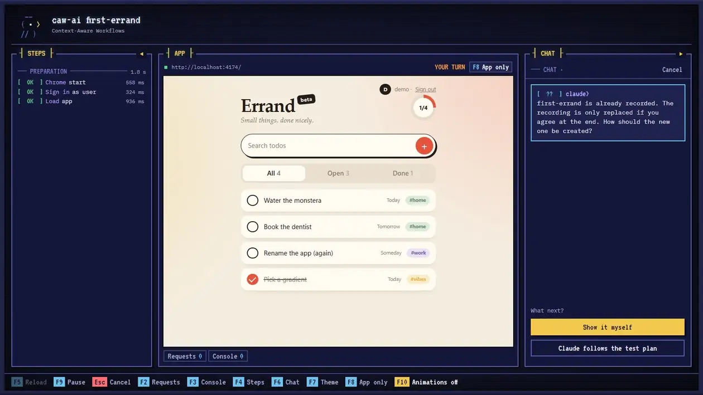

[English](README.md) · Deutsch

# caw-ai

[](https://github.com/lioninacoma/caw-ai/actions/workflows/ci.yml)
[](https://www.npmjs.com/package/caw-ai)
[](LICENSE)

> **caw** – **c**onstrained **a**gentic **w**ebtester
>
> Integrationstests für Web-Apps, in normaler Sprache geschrieben. Claude nimmt jeden Test einmal auf, abgespielt wird ohne KI.
>
> *Constrained*, weil der Agent Grenzen hat: Claude steuert den Browser nur über einen festen Satz Befehle, erreicht nur die Hosts aus deiner Config, sieht nie deine Zugangsdaten, und jede Aufnahme endet mit einem Plan, den du freigibst.



Jeder Schritt beschreibt eine Aktion und das erwartete Ergebnis:

```yaml
# caw/tests/create-ticket.yaml
steps:
  - id: S2
    name: Ticket anlegen
    do: Lege ein neues Ticket "Drucker offline {{runTag}}" für den Kunden "Acme Corp" mit Priorität "High" an.
    expect: Eine Bestätigung nennt die Nummer des neuen Tickets.
```

Einmal aufnehmen, dann abspielen:

```bash
npx caw-ai record create-ticket --target local   # Claude führt die Schritte in Chrome aus, du gibst das Ergebnis frei
npx caw-ai run create-ticket --target local      # spielt die Aufzeichnung ab, ohne Claude
```

## Funktionsweise

- Tests sind YAML-Dateien mit Schritten in normaler Sprache. Beim Aufnehmen führt Claude jeden Schritt in Chrome aus und speichert die Ziele über Rolle, Beschriftung und Text, nicht als CSS-Selektoren.
- Das Abspielen nutzt nur die Aufzeichnung. Es ist deterministisch und verbraucht keine Token, lokal wie in der CI.
- Schlägt ein Schritt fehl, zeigt der Chat neben der App die Ursache. `fix` nimmt nur diesen Schritt neu auf.
- Fehler werden als Test, Anwendung oder Umgebung eingeordnet, anhand von Requests, Konsolenausgaben und den Änderungen an der Seite bei der Aufnahme.
- Claude steuert den Browser über einen festen Satz Befehle, erreicht nur die konfigurierten Hosts und bekommt keine Zugangsdaten.
- Unterstützt: reine Web-Apps, React, Vue, Angular und ExtJS.

## Voraussetzungen

- Node 22+ und Google Chrome unter Windows oder Linux (macOS ungetestet)
- [Claude Code](https://claude.com/claude-code), nur zum Aufnehmen und Reparieren
- Docker, nur wenn Claude im Container laufen soll (`--agent docker`)

## Installation

```bash
npm i -D caw-ai
```

## Verwendung

App starten, dann:

```bash
npx caw-ai init --url http://localhost:5173   # öffnet die App; einmal anmelden, Enter drücken
cp caw/.env.example caw/.env                  # Testkonto eintragen
npx caw-ai doctor                             # listet auf, was noch fehlt
```

Einen Test in `caw/tests/smoke.yaml` beschreiben:

```yaml
id: smoke
app: web
role: tester
targets: [local]
mutates: false
steps:
  - id: S1
    name: Dashboard öffnen
    do: Öffne "Dashboard" in der Navigation.
    expect: Das Dashboard ist sichtbar.
```

Einmal aufnehmen, ab dann abspielen:

```bash
npx caw-ai record smoke --target local
npx caw-ai run smoke --target local
```

[`examples/helpdesk`](examples/helpdesk) enthält eine kleine Beispiel-App mit Test.

### Häufige Befehle

| Aufgabe | Befehl |
|---|---|
| Einen Test laufen lassen | `caw-ai run <test> --target local` |
| Wie in der CI laufen lassen | `caw-ai run <test> --target local --headless` |
| Einen neuen Test aufnehmen | `caw-ai record <test> --target local` |
| Einen geänderten Schritt aktualisieren | `caw-ai fix <test> S3 --target local` |
| Die App in einen Zustand bringen und dort weiterentwickeln | `caw-ai run <test> --target local --until S3` |
| Fehler sofort von Claude erklären lassen | `caw-ai run <test> --target local --advise` |
| Config und Tests prüfen | `caw-ai validate` |

Exit-Codes: `0` bestanden, `1` fehlgeschlagen, `2` Fehler der Umgebung, `3` Eingabe abgewiesen, `4` Aufnahme nötig. Alle Befehle und Optionen: [docs/commands.de.md](docs/commands.de.md).

### In der CI

```yaml
- run: npx caw-ai validate
- run: npx caw-ai run smoke --target staging --headless
```

Mit gesetztem `CI` gibt es keinen Chat, und Claude wird nicht gestartet. Lokal aufnehmen und reparieren, Dateien committen, in der CI abspielen.

### Aus Claude Code

`init` legt auch einen Skill und einen MCP-Server an. Dann in Claude Code:

```
/caw-ai nimm einen Test fürs Anlegen eines Tickets auf
/caw-ai bring mich zur Detailseite des Tickets, ich will am Statusfeld arbeiten
```

## Konfiguration

`caw.config.json` enthält Umgebungen, Anmeldung und Rollen. `init` schreibt sie für dich:

```json
{
  "environments": {
    "local": { "url": "http://localhost:5173", "claude": true, "writable": true }
  },
  "auth": { "type": "form", "path": "/login", "userSelector": "#email", "passwordSelector": "#password",
            "signedInSelector": "[data-testid=user-menu]" },
  "apps": { "web": { "dir": ".", "startUrl": "/" } },
  "roles": { "tester": { "loginEnv": "CAW_LOGIN_TESTER", "passwordEnv": "CAW_PW_TESTER" } }
}
```

Die Anmeldung kann ein Formular sein (optional mit TOTP), HTTP Basic oder eine gespeicherte Sitzung für SSO. Siehe [docs/configuration.de.md](docs/configuration.de.md).

## FAQ

**Kostet jeder Lauf Token?**
Nein. Nur `record`, `fix` und Fragen an Claude im Chat. Bevor Claude startet, fragt der Chat einmal pro Lauf nach; den Hinweis kannst du abschalten.

**Sieht Claude meine Passwörter?**
Nein. caw-ai meldet sich selbst an, bevor Claude startet. Claude kann `caw/.env` nicht lesen und steuert den Browser nur über feste Befehle. Trotzdem Testkonten verwenden: Claude handelt als dieser Nutzer.

**Was passiert, wenn sich die Oberfläche ändert?**
Der Schritt schlägt fehl, und der Chat sagt dir, warum. War die Änderung gewollt, nimmt „Schritt beheben“ diesen Schritt neu auf; der Rest des Tests bleibt, wie er ist.

**Meine App hat keine Anmeldung.**
Lass `auth` und `roles` in der Config weg. `init` macht das von selbst, wenn es kein Anmeldeformular findet.

**Ist das Playwright?**
caw-ai steuert dein installiertes Chrome über Playwright. Playwright-Code schreibst du nicht.

## Doku

- [Befehle](docs/commands.de.md): alle Befehle und Optionen, Exit- und Fehlercodes
- [Konfiguration](docs/configuration.de.md): `caw.config.json`, Anmeldearten, `caw/.env`, `caw/caw.md`
- [Testdateien](docs/test-files.de.md): Testplan, Aufzeichnung, Platzhalter
- [Handbuch](docs/guide.de.md): Agenten, Werkbank, Chat, Einschätzung von Fehlern, Sandbox

## Mitmachen

Issues und Pull Requests sind willkommen, siehe [CONTRIBUTING.md](CONTRIBUTING.md).

## Lizenz

MIT, siehe [LICENSE](LICENSE). Schriften und Grafiken: [NOTICE.md](NOTICE.md).
