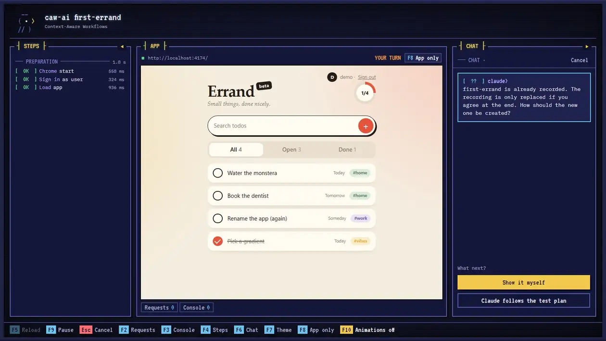
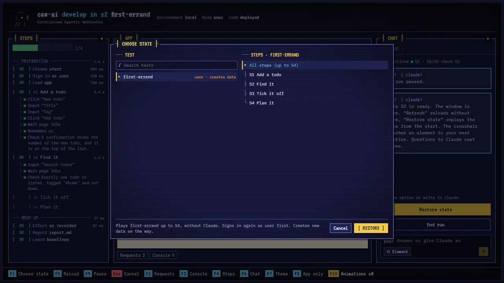
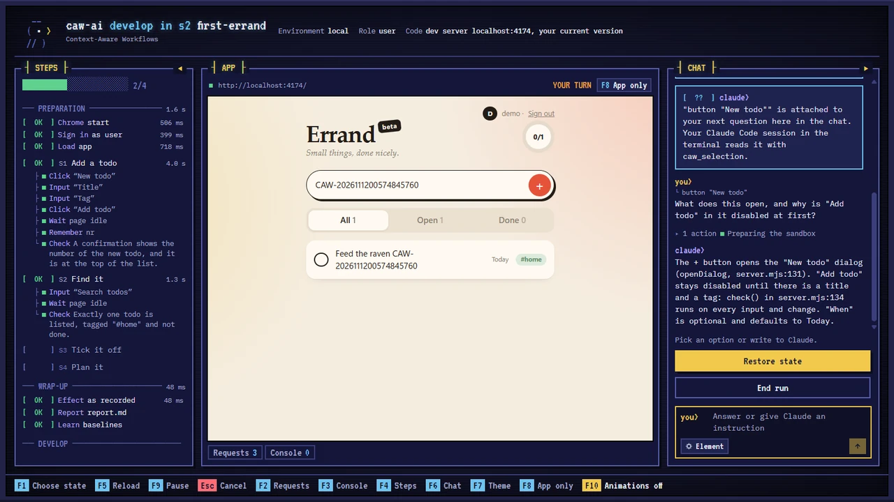
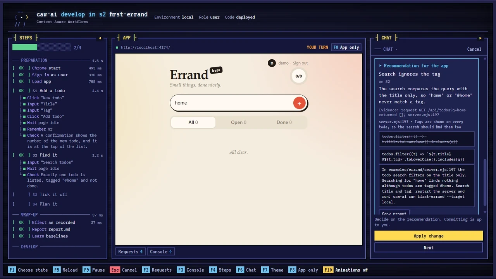
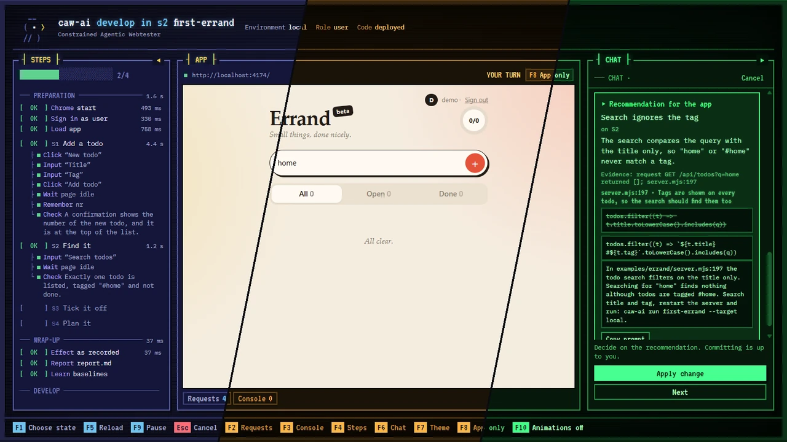

English · [Deutsch](README.de.md)

# caw-ai

[](https://github.com/lioninacoma/caw-ai/actions/workflows/ci.yml)
[](https://www.npmjs.com/package/caw-ai)
[](LICENSE)

> `caw-ai` · *Context-Aware Workflows* · **Show it. Understand it. Replay it.**
>
> AI-powered E2E testing, workflow automation and application debugging.
>
> Describe a test in plain language, Claude walks it once in your real app, and from then on it replays without AI: fast, repeatable, token-free, with Claude back in the chat only when a step breaks.

- **Capture:** demonstrate a real user workflow in your app, or let Claude walk a plan you describe.
- **Understand:** the AI interprets each action in its context: signed-in user, role, application state and goal, not just a click sequence.
- **Replay:** reusable recordings, replayed with Playwright, without AI: deterministic and token-free, locally and in CI.
- **Debug:** investigate and fix issues in the chat next to the running app.



Each step describes an action and the expected result:

```yaml
# caw/tests/first-errand.yaml
steps:
  - id: S1
    name: Add a todo
    do: Add the todo "Feed the raven {{runTag}}" with the tag "#home".
    expect: A confirmation shows the number of the new todo, and it is at the top of the list.
```

Record once, then replay:

```bash
npx caw-ai record first-errand --target local   # Claude performs the steps in Chrome, you approve the result
npx caw-ai run first-errand --target local      # replays the recording, without Claude
```

## How it works

- Tests are YAML files with steps in plain language. While recording, Claude performs each step in Chrome and stores the targets by role, label and text, not as CSS selectors.
- A replay uses only the recording. It is deterministic and uses no tokens, locally and in CI.
- If a step fails, the chat next to the app shows the cause. `fix` re-records only that step.
- After a run the window is yours: F1 restores the state of any test in a fresh session, and Claude in the chat can use the page, reproduce a pasted bug ticket and propose the fix in your code.
- Failures are classified as test, app or environment, based on requests, console output and the page changes seen during recording.
- **Limits by design:** Claude drives the browser only through a fixed set of commands, reaches only the hosts in your config, never sees your credentials; you approve plans that write data and decide whether a recording is adopted.
- Supported: plain web apps, React, Vue, Angular and ExtJS.

## Prerequisites

- Node 22.4+ and Google Chrome on Windows or Linux (macOS untested)
- [Claude Code](https://claude.com/claude-code), for recording and fixing only
- Docker, only if Claude should run in a container (`--agent docker`)

## Install

```bash
npm i -D caw-ai
```

## Usage

Start your app, then:

```bash
npx caw-ai init --url http://localhost:5173   # opens the app; sign in once, click Done
cp caw/.env.example caw/.env                  # add a test account
npx caw-ai doctor                             # lists what is still missing
```

Describe a test in `caw/tests/smoke.yaml`:

```yaml
id: smoke
app: web
role: tester
targets: [local]
mutates: false
steps:
  - id: S1
    name: Open the dashboard
    do: Open "Dashboard" in the navigation.
    expect: The dashboard is visible.
```

Record it once, replay it from then on:

```bash
npx caw-ai record smoke --target local
npx caw-ai run smoke --target local
```

[`examples/errand`](examples/errand) is a small todo app with sign-in and a recorded test you can replay right away; see [`examples`](examples).

### Common commands

| Task | Command |
|---|---|
| Run a test | `caw-ai run <test> --target local` |
| Run it like CI | `caw-ai run <test> --target local --headless` |
| Record a new test | `caw-ai record <test> --target local` |
| Update one changed step | `caw-ai fix <test> S3 --target local` |
| Get the app into a state and keep coding there | `caw-ai run <test> --target local --until S3` |
| Open the app signed in, without a test | `caw-ai open --target local` |
| Test local code inside a deployed environment | `caw-ai run <test> --target dev --overlay` |
| Let Claude explain failures right away | `caw-ai run <test> --target local --advise` |
| Check config and tests | `caw-ai validate` |
| Pick a theme (F7 in the workbench to change one) | `caw-ai theme use phosphor` |

Exit codes: `0` pass, `1` fail, `2` environment error, `3` invalid input, `4` needs recording. All commands and options: [docs/commands.md](docs/commands.md).

### In CI

```yaml
- run: npx caw-ai validate
- run: npx caw-ai run smoke --target staging --headless
```

With `CI` set there is no chat and Claude is not started. Record and fix locally, commit the files, replay in CI.

### From Claude Code

`init` also adds a skill and an MCP server. Then, in Claude Code:

```
/caw-ai record a test for creating a ticket
/caw-ai take me to the ticket detail page, I want to work on the status field
```

## After the run

The window stays open, signed in, in the state the test reached. From there:

### Restore a state

F1 lists every test of the environment, for any role. Pick a test and a step; caw-ai signs in fresh with that role's account and replays up to there.



### Develop

Pick an element in the app and ask about it. Claude reads your source code and answers with file and line. Against your dev server, or with `--overlay` your local code over a deployed environment; F5 loads your change.



### Fix a bug with Claude

Paste a bug ticket into the chat. Claude reproduces it in the reached state, names the cause and proposes the fix as a change to your code; "Apply change" writes it.



### Theming

Three built-in themes, or your own: F7 opens the editor for colors, glyphs, the raven and the CRT look.



## Config

`caw.config.json` holds environments, login and roles. `init` writes it for you:

```json
{
  "environments": {
    "local": { "url": "http://localhost:5173", "claude": true, "writable": true }
  },
  "auth": { "type": "form", "path": "/login", "userSelector": "#email", "passwordSelector": "#password",
            "signedInSelector": "[data-testid=user-menu]" },
  "apps": { "web": { "dir": ".", "startUrl": "/" } },
  "roles": { "tester": { "loginEnv": "CAW_LOGIN_TESTER", "passwordEnv": "CAW_PW_TESTER" } }
}
```

Login can be a form (with optional TOTP), HTTP Basic, or a stored session for SSO. See [docs/configuration.md](docs/configuration.md).

## Data and privacy

**When Claude runs** (`record`, `fix`, the chat, `--advise`), Claude Code sends to Anthropic what Claude works with: page contents (accessibility snapshots, `eval` results, screenshots), console and network summaries, the project source it reads and your chat messages. Your Claude Code account and its terms apply.

**Masked or blocked:** caw-ai signs in itself; the role's password and values marked `secret: true` are replaced with `••••` before Claude sees text. `caw/.env`, `.env*`, `caw/.auth` and typical key files are blocked for Claude (Claude Code deny rules locally, hidden in the Docker container). Other secrets in project files Claude may read are not, and Claude sees everything the test user sees in the app: use test accounts and test data. Details: [Sandbox boundaries](docs/guide.md#sandbox-boundaries).

**Replays** (`run` without chat, CI) send nothing to any AI.

**No telemetry:** caw-ai itself reports nothing anywhere. Its own network traffic goes to your environments and `extraAllowedHosts`, plus package downloads when the Docker image is built; in the Docker sandbox, Claude Code reaches only the Anthropic API (`CLAUDE_CODE_DISABLE_NONESSENTIAL_TRAFFIC=1`).

**Run data** stays on your machine in `.caw/runs/<run>/`: report, `result.json`, screenshots, Claude's logs and `trace.zip`. The trace contains page contents and network data including cookies; don't upload it or run folders publicly. `init` adds `.caw/` to `.gitignore`.

## Status and roadmap

Beta. Minor versions may break things before 1.0; the [changelog](CHANGELOG.md) lists each break with upgrade notes ([from 0.1.0](docs/upgrading.md)).

Supported: Google Chrome or another Chromium-based browser (`browser` in the config), Windows and Linux, Node 22.4+. macOS is untested.

Not yet, or not planned:

- **Parallel runs and sharding:** tests run one after another.
- **Firefox and WebKit:** Chromium only.
- **Setup and teardown hooks for test data:** prepare data outside caw-ai, e.g. in a CI step, or as steps of the test.
- **Network mocking:** tests run against the real backend of the environment.
- **Visual diffs:** steps check content and state, not pixels.
- **Other AI providers:** caw-ai works with Claude Code only. Recording, fixing and the chat need it; replays need no AI.

## FAQ

**Does every run cost tokens?**
No. Recording, `fix` and the chat use Claude tokens, billed through your Claude Code account; replays use none, locally and in CI. Before Claude starts, the chat asks once per run; you can turn that notice off. The run log shows the cost Claude Code reports.

**Does Claude see my passwords?**
No. caw-ai signs in itself before Claude starts. Claude can't read `caw/.env` and only drives the browser through fixed commands. Use test accounts anyway: Claude acts as that user.

**What happens when the UI changes?**
The step fails and the chat tells you why. If the change was intended, "Fix step" re-records that step; the rest of the test stays as it is.

**My app has no login.**
Leave `auth` and `roles` out of the config. `init` does that for you when it finds no login form.

**Is it Playwright?**
It uses Playwright to drive your installed Chrome. You don't write Playwright code.

## Docs

- [Commands](docs/commands.md): every command and option, exit and error codes
- [Configuration](docs/configuration.md): `caw.config.json`, login types, `caw/.env`, `caw/caw.md`
- [Test files](docs/test-files.md): test plan and recording format, placeholders
- [Guide](docs/guide.md): agents, workbench, chat, failure assessment, sandbox
- [Upgrading from 0.1.0](docs/upgrading.md): renamed config keys, exit codes and files
- [Themes](themes/README.md): built-in themes, own theme packages, `caw-ai theme`

## Contributing

Issues and pull requests are welcome, see [CONTRIBUTING.md](CONTRIBUTING.md).

## License

MIT, see [LICENSE](LICENSE). Fonts and graphics: [NOTICE.md](NOTICE.md).
