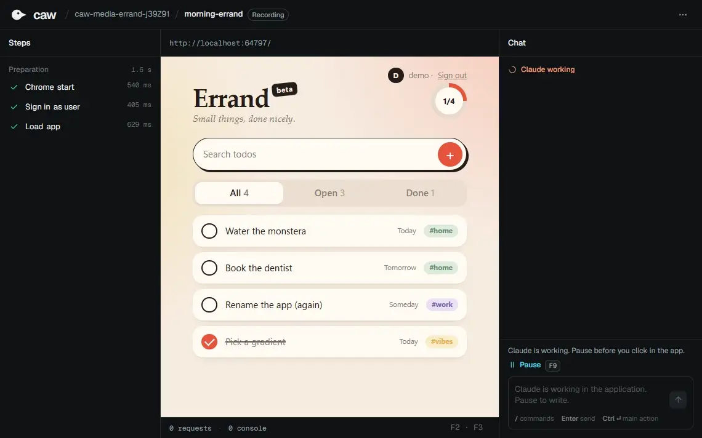
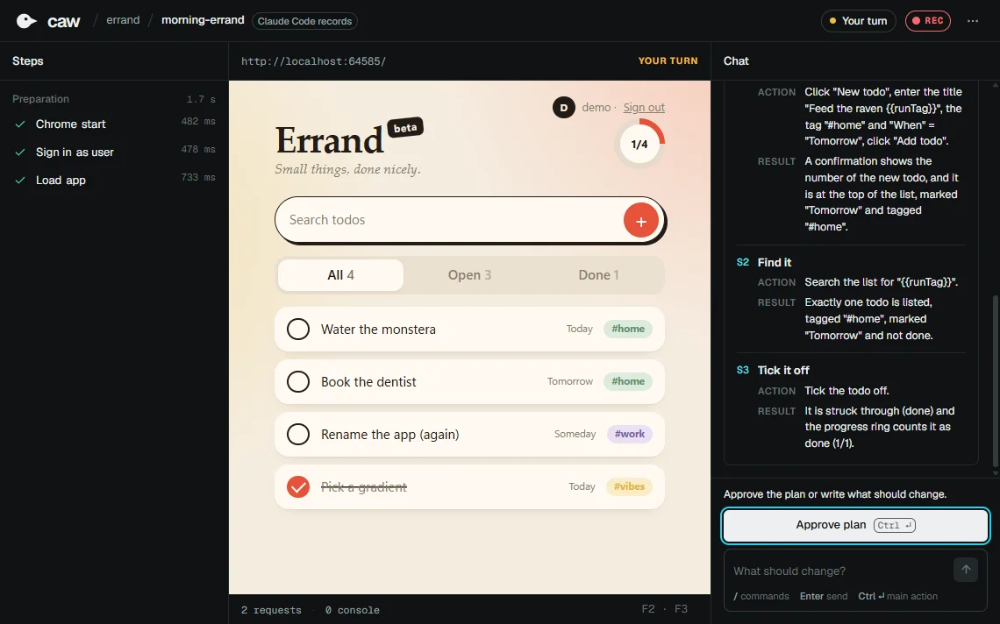
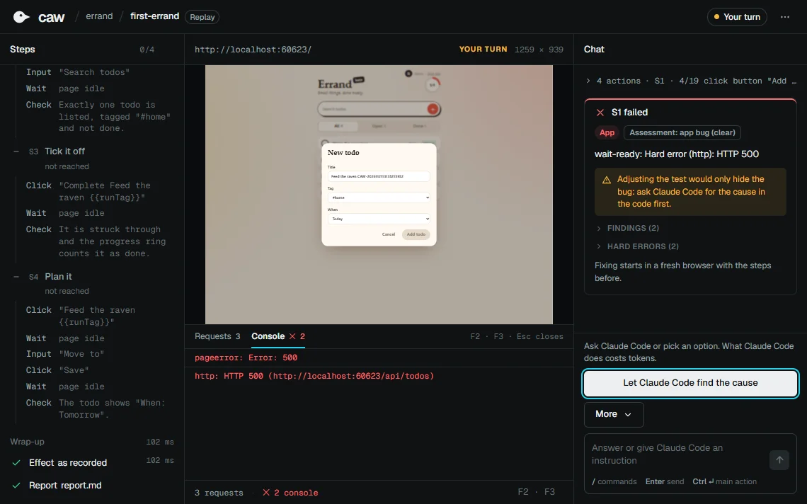
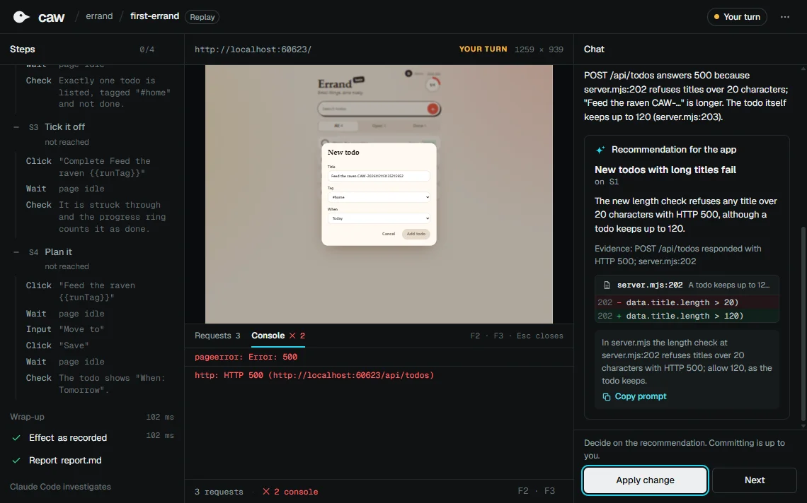
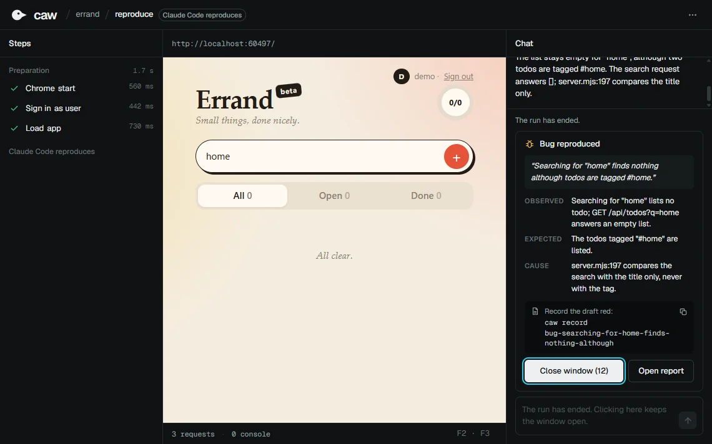
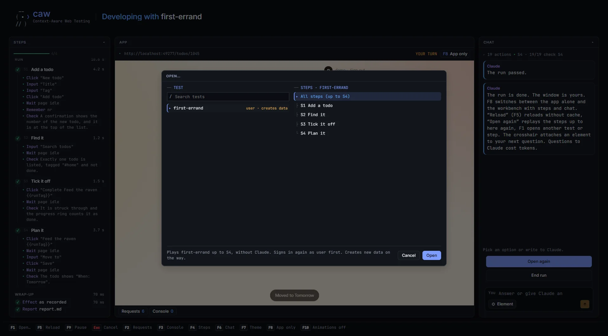
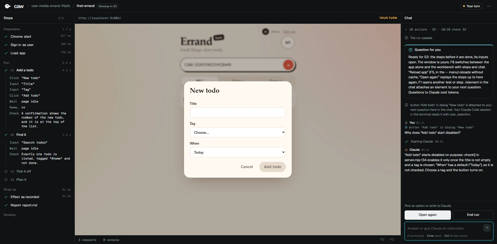

English · [Deutsch](README.de.md)

# caw-ai

[](https://github.com/lioninacoma/caw-ai/actions/workflows/ci.yml)
[](https://www.npmjs.com/package/caw-ai)
[](LICENSE)

> `caw` · *Context-Aware Web Testing*
>
> **Target-driven development for web apps: write the test first, caw checks it without AI.**
>
> The test plan is the specification, in plain language, before the screen exists. caw checks it without AI until your app
> meets the target, then keeps it as a regression test. It judges a failure as app, environment or test without AI, holds an
> agent to the checks it must keep, and takes you to any state of your app.



- [Why not just Playwright?](#why-not-just-playwright)
- [Quick start](#quick-start)
- [Expectations are the yardstick](#expectations-are-the-yardstick)
- [Test, app or environment, without AI](#test-app-or-environment-without-ai)
- [Reproduce bugs](#reproduce-bugs)
- [Reach any state and develop](#reach-any-state-and-develop)
- [A box for the agent](#a-box-for-the-agent)
- [Visual checks](#visual-checks)
- [Drive it from Claude Code](#drive-it-from-claude-code)
- Reference: [prerequisites](#prerequisites), [commands](#common-commands), [CI](#in-ci), [config](#config),
  [data and privacy](#data-and-privacy), [what caw is not](#what-caw-is-not), [FAQ](#faq), [docs](#docs)

## Why not just Playwright?

Playwright, its MCP server and its test agents already let an agent write, run and heal tests, and caw runs on Playwright. caw
adds what generated test code doesn't give you:

- **Checks an agent must keep.** Each check belongs to a plain-language expected result. While the expectation stays, an
  agent that fixes a step or records the test again must keep the check; caw refuses the recording otherwise. A changed
  expectation is your decision. When the evidence points at your app, caw shows the cause instead of offering a test edit.
- **Judging without AI.** A failure is classed as test, app or environment (or unclear) from requests, console and learned
  effects; once five healthy runs have taught a step's effects, changed controls or console fail it by default.
- **A target before the screen.** Steps not built yet stay pending, with a target design and what must be on the page. Runs
  say without AI when a step is ready to record, and judge its screen against the design once it is recorded.
- **A box for the agent** (when caw starts it): read-only tools or a firewalled container, a browser that reaches only your
  environments, production read-only.
- **States, not just tests.** Any step of any test is a place to open, reproduce a bug from or develop in.

Use plain Playwright for cross-browser runs, parallel sharding, network mocking or a large suite developers maintain in code.

### Export to Playwright

The way out: `caw export <test>` writes a recorded test as a Playwright test that runs without caw, only with
`@playwright/test`: the recorded locators, one `test.step()` per step, sign-in included. caw's triage and learned effects stay
behind.

```bash
npx caw export first-errand --env local
npx playwright test -c caw/export/playwright
```

Details: [Commands](docs/commands.md#export).

## Quick start

Node 22.4+, Chrome and, for recording, [Claude Code](https://claude.com/claude-code). Start your app, then:

```bash
npm i -D caw-ai
npx caw init --url http://localhost:5173   # writes caw.config.json; with --explore-only it looks at the app first
npx caw doctor                             # lists what is still missing
```

`init` asks for the role names and lists their variables in `caw/.env.example`. Put the test user into `caw/.env` yourself
(`CAW_TESTER_USER`, `CAW_TESTER_PASSWORD`). Then describe a test in `caw/tests/smoke.yaml`:

```yaml
id: smoke
role: tester
writes: false
steps:
  - id: S1
    name: Open the dashboard
    do: Open "Dashboard" in the navigation.
    expect: The dashboard is visible.
```

Record it once, replay it from then on:

```bash
npx caw record smoke --env local   # once, with the agent
npx caw run smoke --env local      # from then on, without AI
```

To try it without your own app: [`examples/errand`](examples/errand) is a small todo app with sign-in and a recorded test you
can replay right away.

## Expectations are the yardstick

A test is a plan in plain language: per step what a user does and one expected result. You show the way in the app or describe
it in the chat; the agent proposes the plan, you approve it, and the agent walks it. Its walk is the recording, checked by a
run without AI before you adopt it. From then on the test replays with Playwright, locally and in CI: deterministic, fast,
without tokens.



```yaml
# caw/tests/first-errand.yaml
id: first-errand
role: tester
writes: true
steps:
  - id: S1
    name: Add a todo
    do: Add the todo "Feed the raven {{runTag}}" with the tag "#home".
    expect: A confirmation shows the number of the new todo, and it is at the top of the list.
  - id: S4
    name: Plan it
    do: Open the todo and move it to "Tomorrow".
    expect: 'The todo shows "When: Tomorrow".'
    design: design/todo-detail.html
    needs: ["getByRole('list', { name: 'Todos', exact: true })"]
```

Each check belongs to its expected result. While the expectation stays, an agent that fixes or re-records the step must keep
the check: caw refuses the recording otherwise. To change a check on purpose, change the expected result.

**Target designs.** Write the next steps before the app can do them. Steps at the end that are not recorded yet are pending:
`run` plays the rest and passes, and names them. A step can name the screen it should end on (`design:`, an `.html` or `.png`
in `caw/design`) and what must be on the page before it can be recorded (`needs:`). Only people write both. A run checks the
first pending step's `needs` and says "S4 is ready to record" once they are there. Once S4 is recorded, every run judges its
screen without AI after its check passed (controls, headings, a few styles per control; pixels for a `.png`): not met, the
step fails with kind `design` until the screen matches. `caw open <test>@S4 --design` lays the design over the app.

```bash
npx caw run first-errand --env local              # S1–S3 play, S4 pending; "S4 is ready to record" once its needs are met
npx caw open first-errand@S4 --design --env local # the design over the app, the deviations listed below
npx caw record first-errand@S4 --env local        # record S4 once the screen is built
```

A recording stores each target as a Playwright locator (role, name, label, text) next to the plan. A test runs on every
environment it fits (local dev server, staging, a CI stack caw starts itself), writing tests only where writing is allowed.
Details: [Guide](docs/guide.md#plain-language-tests-record-once-replay-without-ai),
[target design](docs/guide.md#develop-against-a-target-design), [pending steps](docs/test-files.md#pending-steps).

## Test, app or environment, without AI

When a step breaks, caw tells you whether the test, the app or the environment is at fault, from the requests and console
output it saw and the effects it learned. No AI is needed for that. A step's effects are learned over its first five healthy
runs and then frozen: the controls it changes, its requests, the shape of their responses and its console messages. Changed
controls or new console messages fail the step by default, the rest warns.





In the chat the agent finds the cause on request, "Fix step" re-records only that step after an intended change, and a fix for
the app comes as a code change you accept or reject. If a button was only renamed, caw proves the new target without AI and
offers it.

- **`result.json`** lists every step: status, why it failed, its time, its requests and effects.
- **Typed CI:** JUnit types a failed step by the assessment (`<failure type="app|environment|test|unclear">`);
  `--report summary=` writes a line per test for the job summary.
- **`--retry-env <n>`** runs a test again only while it fails on the environment.
- **`caw bisect`** finds the commit that broke a test, with `git bisect run`.
- **`caw audit <ref>`** lists every change that weakens a test (a check changed while its expectation stayed, a step removed,
  a timeout raised …), as Markdown for a PR comment; exit 1 when a test got weaker.

```bash
npx caw run first-errand --env local --explain   # the agent explains a failure right away
npx caw run --all --env staging --headless --retry-env 1 --report junit=out/caw.xml --report summary=out/summary.md
npx caw audit origin/main                        # in a PR: did a test get weaker?
```

Details: [Triage and repair](docs/guide.md#triage-and-repair), [audit](docs/guide.md#no-test-gets-weaker-unnoticed-audit),
[bisect](docs/commands.md#bisect), [CI](docs/commands.md#several-tests-ci).

## Reproduce bugs

Hand the agent a bug report. It signs in as a test role, walks the report on its own and tells you whether the bug is real:
yes, no or unclear, with what it observed against what was expected, the steps it took, screenshots and a hint at the cause
in your code.



```bash
npx caw reproduce "Searching for home finds nothing although todos are tagged #home." --env local
npx caw reproduce --file bug.md --from first-errand@S3 --ref BUG-42 --env local --headless
```

A reproduced bug leaves a draft test in `caw/drafts`, the way to a proven fix:

1. **Red:** `caw record <draft>` records it; its last step must fail while the bug is there.
2. **Fix:** you fix the bug, by hand or with your attached session.
3. **Green:** `caw run <draft>` replays it without AI.
4. **Promote:** `caw run <draft> --promote` needs the draft and `run --all` green, then moves it to `caw/tests` and writes a
   fix report.

With a window the chat guides you through all four in one process: **Record red**, **Now fix the bug** (by yourself or with
the agent, whose code changes you apply card by card), **Test again** and **Adopt**.

No plan to approve and no question to you: the agent only investigates. It runs only on environments you allow an agent on,
never on production, only reads where the environment is not `writable`, and changes no code and no test. `--ref` keeps a
ticket id from another tool in the report; caw never looks it up. Details:
[Guide](docs/guide.md#reproducing-a-bug-reproduce), [from the bug to a proven fix](docs/guide.md#from-the-bug-to-a-proven-fix),
[tickets](docs/guide.md#tickets-from-another-tool).

## Reach any state and develop

`caw open <test>@S3` signs in with the test's role, replays up to the entry of S3 and hands you the window: its navigation
done, its inputs open. F1 ("Open…") picks any test and step of the environment, for any role.



Pick an element in the app (`/element` in the chat) and ask about it: the agent reads your source code and answers with file
and line. Against your dev server, F5 loads your change.



```bash
npx caw open first-errand@S3 --env local   # the state before S3, signed in, the window is yours
npx caw open --env local                   # the app, without a test
```

Details: [Guide](docs/guide.md#reach-any-state-and-develop).

## A box for the agent

caw's own agent drives the browser only through fixed commands, never on production. Where it runs:

| Agent | How it runs | What it may do |
|---|---|---|
| `local` (default) | Claude Code on your machine | read the project (`Read`, `Grep`, `Glob`) and the caw tool; no shell, no writing, no web; `caw/.env` and key files denied |
| `docker` (`--agent docker`) | Claude Code in a container, API key only | the project read-only, `.env` files hidden; the firewall lets through only the Anthropic API |
| `--attach` | your own Claude Code session | your session's own permissions; caw adds the browser commands. It may change the app's code when you ask in the chat |

In every case, while an agent can act in the window (record, reproduce, a run with chat, `open`), the browser reaches only your
environments, `allowHosts` and `thirdPartyHosts`; everything else is blocked and named in the run.

- **Test accounts stay yours:** you put them into `caw/.env` (or CI secrets) yourself. caw signs in, never asks for them and
  never writes them, and the password is masked in everything the agent gets.
- **Production is read-only:** a run on production sends no write requests, and production hosts are unreachable from every
  other environment. Limits: messages over a WebSocket and production reached by IP address are not blocked
  ([Limits](docs/guide.md#limits), [Sandbox boundaries](docs/guide.md#sandbox-boundaries)).

Sign-in: login forms, one-time codes, steps on an identity provider (e.g. Keycloak), HTTP Basic, stored sessions. What masking
can and cannot do: [Data and privacy](#data-and-privacy).

## Visual checks

- **Per step:** `look: true` on a step (only people set it) learns its look: style lines per role over two passed runs,
  an image over two matching headless runs. A later change fails the step with kind `visual`; **Adopt new look** in the chat takes it over, and `caw audit` lists
  that. After `caw record` the check run suggests steps whose screen shows no data from the server.
- **Pixels headless only:** pixels are learned and compared in `--headless` runs at a fixed viewport; a run in the window
  compares the styles only.
- **Fixed data:** for a screen whose data changes, **Freeze data** stores the JSON answers of the app's reads in
  `caw/recordings/<test>/fixed-data.json`. They can contain personal data: you choose anonymized, obfuscated (no protection)
  or readable after confirming you checked data protection, and review them first. Headless runs compare those looks in a
  pass of their own; the run's checks always see the real backend. Never in CI.
- **Design tokens:** with tokens in `caw/design`, every run lints colors, spacing, contrast, clipped text and unnamed controls.

Limits: images are per platform (fonts render differently on Windows and Linux), thresholds are starting values, and only JSON
answers are frozen (server-rendered HTML and WebSocket data stay live). Details:
[Visual regression](docs/guide.md#visual-regression), [fixed data](docs/test-files.md#fixed-data).

## Drive it from Claude Code

Register caw as an MCP server of the project, then ask your session: set up the project, record, run, reproduce, take you to
a state. The session is the agent itself, at no extra tokens.

```bash
claude mcp add caw --scope project -- npx caw-ai mcp
```

On Windows (not WSL): `claude mcp add caw --scope project -- cmd /c npx caw-ai mcp`. To work with your session in a caw window,
type `/caw-attach` (the skill comes with `caw init` or `caw skill`) or pass `--attach` to `run`, `record`, `open` or
`reproduce`. Details: [Guide](docs/guide.md#drive-it-from-claude-code).

## Prerequisites

- Node 22.4+ and Google Chrome (or another Chromium browser) on Windows or Linux (macOS untested)
- [Claude Code](https://claude.com/claude-code), for recording, reproducing and fixing only
- Docker, only if the agent should run in a container (`--agent docker`)

Works with plain web apps, React, Vue, Angular, Next.js, Nuxt and server-rendered multi-page apps.
Extensions add [ExtJS](docs/extensions/extjs.md) and [local code on deployed portals](docs/extensions/overlay.md).

### Claude access and costs

caw does not call Claude itself. It starts your own Claude Code (`--agent local`), works as a tool in your Claude Code session
(`--attach`), or passes your own `ANTHROPIC_API_KEY` into the container at run time (`--agent docker`, API key only); it
never reads or stores it. Which terms apply depends on your account: Pro and Max plans are for personal use; for company
projects and CI use a Team or Enterprise plan or an API key from the Claude Console. Complying with Anthropic's terms is up to
you.

Claude only runs while recording, reproducing, fixing or when you ask in the chat; replays use no tokens. Usage is billed to
your account. To cap it, set a model and a budget per Claude run:

```json
"agent": { "model": "haiku", "maxBudgetUsd": 0.5 }
```

or for one run `CAW_AGENT_MODEL=haiku CAW_CLAUDE_BUDGET=0.5`. caw passes them to Claude Code as `--model` and
`--max-budget-usd`.

## Common commands

| Task | Command |
|---|---|
| Run a test | `caw run <test> --env local` |
| Run it like CI | `caw run <test> --env staging --headless` |
| Run all tests that fit an environment | `caw run --all --env staging` |
| Record a new test | `caw record <test> --env local` |
| Re-record from a changed step to the end | `caw record <test>@S3 --env local` |
| Let the agent reproduce a bug report | `caw reproduce "<bug report>" --env local` |
| Promote a green draft to a regression test | `caw run <draft> --env local --promote` |
| Get the app to the start of a step and keep coding there | `caw open <test>@S3 --env local` |
| Lay a step's target design over the app | `caw open <test>@S4 --design --env local` |
| Open the app without a test | `caw open --env local` |
| Let the agent explain failures right away | `caw run <test> --env local --explain` |
| List what weakened a test since a branch | `caw audit origin/main` |
| Find the commit that broke a test | `git bisect run npx -p caw-ai@<version> caw bisect <test> --env local` |
| Export a test to Playwright | `caw export <test>` |
| Check config and tests | `caw validate` |

Exit codes: `0` pass, `1` fail, `2` environment error, `3` invalid input, `4` needs recording. All commands and options:
[docs/commands.md](docs/commands.md).

### In CI

```yaml
- run: npx caw validate
- run: npx caw run --all --env staging --headless --retry-env 1 --report junit=out/caw.xml
```

With `CI` set there is no chat and no agent, and a run learns only with `--learn`. Record locally, commit the files, replay in
CI. Pass the test users as secrets named after the role: `CAW_TESTER_USER`, `CAW_TESTER_PASSWORD` (and `CAW_TESTER_TOTP` for
one-time codes), optionally per environment with a suffix, e.g. `CAW_TESTER_USER__STAGING`. An environment with `start`,
`stop` and `reset` commands is started by `--start` and reset before the first writing test. Scheduled runs against
production: [Monitoring production](docs/guide.md#monitoring-production).

## Config

`caw.config.json` holds environments, sign-in and roles. `init` writes it for you:

```json
{
  "environments": {
    "local":   { "url": "http://localhost:5173", "agent": true, "writable": true },
    "staging": { "url": "https://staging.example.com" }
  },
  "signIn": { "type": "form", "path": "/login", "userSelector": "#email", "passwordSelector": "#password",
              "signedInSelector": "[data-testid=user-menu]" },
  "roles": { "tester": {} }
}
```

Notes for the agent go into the project's `caw/caw.md` and into your own `caw.md` next to your personal settings, for every
project. See [docs/configuration.md](docs/configuration.md).

## Data and privacy

**When the agent runs** (`record`, `reproduce`, the chat, `--explain`), Claude Code sends to Anthropic what the agent works with: page
contents (accessibility snapshots, `eval` results, screenshots), console and network summaries, the project source it reads,
your notes in `caw.md` and your chat messages. Your Claude Code account and its terms apply.

**Masked or blocked:** caw signs in itself; the role's password, one-time codes and values marked `secret: true` are replaced
with `••••` in everything the agent gets (error messages, URLs and dialog texts too). That keeps a value from reaching the agent by
accident; a deliberately misbehaving agent can transform a value in the page with `eval` (split, encode) and read it past the
mask. `caw/.env`, `.env*`, `caw/.auth` and typical key files are blocked for the agent (Claude Code deny rules locally, hidden in
the Docker container). Other secrets in project files the agent may read are not, and the agent sees everything the test user sees
in the app: use test accounts and test data. Details: [Sandbox boundaries](docs/guide.md#sandbox-boundaries).

**Replays** (`run` without chat, CI) send nothing to any AI.

**No telemetry:** caw reports nothing anywhere. Its own network traffic goes to your environments and `allowHosts` and to what
the app's pages load themselves (scripts, fonts, analytics), plus package downloads when the Docker image is built; in the
Docker sandbox, Claude Code reaches only the Anthropic API (`CLAUDE_CODE_DISABLE_NONESSENTIAL_TRAFFIC=1`).

**The browser is outside that firewall:** Chrome runs on your machine. While an agent can act in the window (record,
reproduce, a run with chat, `open`), every request of its pages goes only to your environments, `allowHosts` and
`thirdPartyHosts`; anything else is aborted and named in the run, so a page the agent drives cannot send what it sees
elsewhere. Without an agent (replays, CI) pages load from any host except production. Details:
[Sandbox boundaries](docs/guide.md#sandbox-boundaries).

**Run data** stays on your machine in `.caw/runs/<run>/`: report, `result.json`, screenshots, the agent's logs and `trace.zip`.
The trace contains page contents and network data including cookies; don't upload it or run folders publicly. `init` adds
`.caw/` to `.gitignore`. Fixed data for a look is a file in the repository; check it for personal data before you commit it.

## What caw is not

- An autonomous exploratory tester: the agent follows your plan or your bug report.
- A Playwright IDE: you don't write locators or code (`caw export` is the way out).
- A visual testing service for whole sites: visual checks run only on steps you mark with `look: true` or give a design.
- An API, load or security testing tool: steps check what a user sees and does in the browser.
- A cross-browser grid: Chromium only.
- A network-mocking framework: tests run against the real backend; only a look pass serves frozen data.
- Parallel: tests run one after another.
- A ticket system client: caw keeps a ticket id, it never looks it up.

Other AI providers are not supported: recording, reproducing, fixing and the chat need Claude Code; replays need no AI.

## FAQ

**Does every run cost tokens?**
No. Recording, reproducing and the chat use Claude tokens, billed through your Claude Code account; replays use none, locally
and in CI. Before the agent starts, the chat asks once per run (not when your own Claude Code session is the agent); you can turn
that notice off. The run log shows the cost Claude Code reports.

**Does the agent see my passwords?**
Not by accident. caw signs in itself before the agent starts (and takes no commands while it signs in again), the the agent that
caw starts can't read `caw/.env` (an attached session has its own permissions) and only drives the browser through fixed
commands, and the password is masked in everything the agent gets.
The mask is no defence against a deliberately misbehaving agent: with `eval` it can transform a value in the page. So use
test accounts: the agent acts as that user.

**Can `reproduce` break something?**
Only where you let the agent write: on an environment without `writable` every write request is blocked, production is never
allowed, and the agent changes neither code nor tests. The draft test goes into `caw/tests` only when you promote it, red
before and green after.

**What happens when the UI changes?**
The step fails and the chat tells you why. If the change was intended, "Fix step" re-records that step; the rest of the test
stays as it is. If only a button was renamed, caw proposes the new target with proof.

**My app signs in through SSO.**
Let caw fill the identity provider's form with `signIn.steps` (`init --explore-only` suggests them), or sign in once by hand
with `caw role login` and let caw reuse the stored session.

**My app has no sign-in.**
Leave `signIn` and `roles` out of the config. `init` does that for you when it finds no sign-in form.

**Is it Playwright?**
It uses Playwright to drive your installed Chrome, and recordings store Playwright locators. You don't write Playwright code;
`caw export` turns a test into one if you want to leave.

## Docs

- [Guide](docs/guide.md): every feature in detail, agents, workbench, chat, failure assessment, sandbox
- [Commands](docs/commands.md): every command and option, exit and error codes
- [Configuration](docs/configuration.md): `caw.config.json`, environments, sign-in, roles, `caw/.env`, `caw.md`
- [Test files](docs/test-files.md): test plan and recording format, pending steps, target designs, placeholders
- Extensions: [overlay](docs/extensions/overlay.md) (local code on a deployed environment), [ExtJS](docs/extensions/extjs.md)

## Contributing

Issues and pull requests are welcome, see [CONTRIBUTING.md](CONTRIBUTING.md).

## License

MIT, see [LICENSE](LICENSE). Fonts and graphics: [NOTICE.md](NOTICE.md).

Claude and Claude Code are trademarks of Anthropic, PBC. caw is not affiliated with or endorsed by Anthropic.
